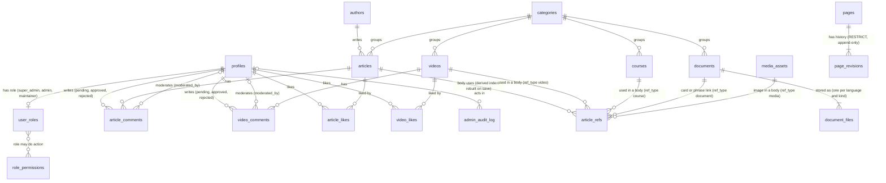
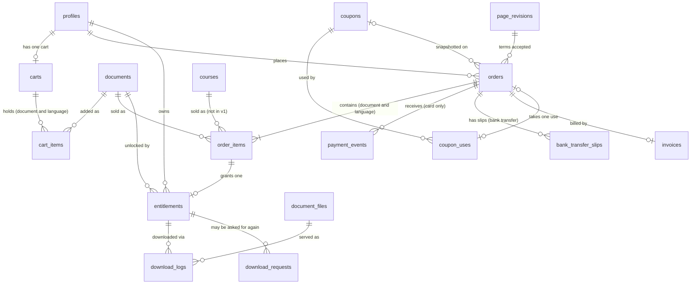

# CeylonSafety - Database Schema (Section 2, revised v15)

Status: DRAFT v15 - documentation only (not migration code). Aligned with requirements v12, the content system design v3.1 (decisions D1 to D9 accepted by the project owner), the advertising design v2.1, the trainer and public pages design v2.1, the admin panel design v2 and the decisions summary (2026-10-17-ceylonsafety-decisions-schedule-and-fixes.md, Part 3.1). Items marked ASSUMPTION are our recommendation, not a client or owner answer; they are listed in section 11. Items marked PROPOSED wait for an owner decision; the merged decision id (M number) from the decisions summary is given next to them. Error codes follow the common list in the authentication design section 17; this schema defines no other code names.
Date: 2026-10-17 (first written 2026-10-11)
Depends on: requirements v12 (2026-10-13 file), commerce design v5, authentication design v7, file-structure v7, content system design v3.1, advertising design v2.1, trainer and public pages design v2.1, admin panel design v2. This version keeps the names CONFIRMED in v13 (the provisional names those documents used: `coupons`, `coupon_uses`, `carts`, `cart_items`, `document_files.language`, `download_requests`, `bank_transfer_slips`, `role_permissions`, `has_permission(action)`, order status `pending_verification`, setting `default_download_limit`, roles `super_admin`, `admin`, `maintainer`).
History: v15 (fix round: banner link rule and limits, `banner_clicks` removed, trainer and page changes, permission names and seeds, audit event list, audit purge function, settings groups and keys, jobs; 38 active tables plus 2 parked; see section 29) <- v14 (content system design v2 alignment: article body as one JSON document, `article_sections` removed, `article_refs` added, `article_document_links` merged into it, video and comment changes, audit actions, seed for the Admin role, decisions D1 to D9; 39 active tables plus 2 parked; see section 28) <- v13. v12 was skipped so the version number matches the other design documents. v13 (requirements v12 alignment: one document row with a language per file, one entitlement per purchased order line, one download per purchase with a setting, download requests, bank transfer with slips, coupons, database cart, three staff roles, comment approval, no bulk discount, no refunds, no enquiries, no banner scheduling, idle-account deletion, counters, search scope; 40 active tables plus 2 parked; see section 27) <- v11 (36 tables) <- earlier history: v1 (23 tables) -> v2 (33 tables, security and payment fixes) -> v3 (36 tables, second-pass gap fixes, operations section) -> v4 (third-pass fixes: dependency order, uploads, Supabase security rules, workflow; still 36 tables) -> v5 (relationship diagrams, state machines, page-to-data map, small decisions; still 36 tables) -> v6 (changes required by the authentication design v2: signup trigger sanitising, welcome-email uniqueness, two new jobs; still 36 tables) -> v7 (changes required by the authentication design v3: profile sanitising trigger, database-level comment and like limits, staff flag in public_profiles, shared profile-creation function; still 36 tables) -> v8 (changes required by the commerce design v1: finalize marker, cancel reason, refund method, two new jobs; still 36 tables) -> v9 (changes from the commerce design v2: event processing marker, invoice seller snapshot, refund requests, receipt uniqueness, download release, replay job; still 36 tables) -> v10 (changes from the commerce design v3: stored payment method, discount cap, entitlement revocation rule, net revenue report; still 36 tables) -> v11 (changes from the commerce design v4: slow-payment expiry rule, per-item purchase count, publish rule for documents; still 36 tables).
Database: Supabase PostgreSQL. Auth: Supabase Auth. Files: Cloudflare R2.

## 1. Conventions (apply to every table)

| Topic | Rule |
|---|---|
| IDs | `uuid`, generated by the database |
| Money | Integer minor units, column names end in `_cents` (LKR 2,500.00 = 250000). Convert to PayHere's `"2500.00"` string in ONE place (`lib/payhere/checkout.ts`) |
| Time | `timestamptz`, stored in UTC. Date filters ("last week", daily sales) are computed in Asia/Colombo |
| Status fields | `text` with a CHECK constraint listing allowed values (not Postgres enums, which are hard to change) |
| Soft delete | `deleted_at` on articles, videos, documents, courses, profiles. Never hard-delete anything that appears in an order. Unique slugs (and `youtube_id`) apply only to rows where `deleted_at IS NULL`, so a deleted item's slug can be reused |
| `updated_at` | Maintained by one shared trigger (Postgres does not do it automatically) |
| Language | Two different things (REQ-060c, requirements B1 finding 10). WEBSITE language: articles, videos, courses and pages carry `locale` (`en`, `si`, `ta`) and `translation_group_id`; each language is its own row; slugs are unique per locale; launch = `en` only. DOCUMENT language: a document is ONE row (English title and description only) and each language is a row in `document_files` with a `language` column (`en`, `si`, `ta`). The cart line, order line and entitlement carry the chosen document language. `documents` has NO `locale` and NO `translation_group_id` |
| Search | Each searchable row has a `search_vector` maintained by a trigger that picks the text-search config from `locale` (`english` for en, `simple` for si/ta). A trigram index on titles handles partial words. Caveat: Postgres may split Sinhala/Tamil words incorrectly (combining marks), so test with real text before launching those languages; an external search service may be needed |
| Files and images | Private files (documents, previews, invoices) store an R2 object KEY. Public images store a media KEY too (not a full URL); the full URL is built by one helper from the `PUBLIC_MEDIA_BASE_URL` environment variable, so a domain change never breaks stored data. Columns are therefore named `*_key` (e.g. `cover_image_key`). External URLs (Google avatar) stay `*_url`. The YouTube thumbnail is copied into our bucket and stored as a key (`videos.thumbnail_key`, v14). Size variants of an image (WebP copies at about 480 and 1200 pixels wide, only up to the original width) are named by a fixed rule from the file key, so there is no variant column |
| IP addresses | Stored only as a keyed hash (`ip_hash`), never raw, because they are personal data |
| Foreign keys | Every FK states its delete rule. Default is RESTRICT; CASCADE only for owned children |
| Prices | Server always recalculates from the database. The browser's price or total is never trusted |
| Writes | All writes go through Next.js server code (server actions or API routes). Row-level security stays on as a second layer of protection. Limits and rules that must hold even when someone calls the database API directly (profile field sanitising, comments and likes per hour) are enforced by database triggers, never only by server code |
| Hidden content | Anything that points at hidden, unpublished or deleted content (links inside articles, video blocks, course and document cards, ad slots) renders nothing. The page never errors |
| Append-only | `payment_events`, `page_revisions` and `admin_audit_log` cannot be updated or deleted; a trigger enforces it. Two named exceptions only: `purge_old_logs()` may clear `payment_events.raw_payload`, and `purge_old_audit_rows(cutoff)` (v15, service role only) may delete `admin_audit_log` rows older than the retention cut-off |
| Error codes | The server maps database errors to the common list in the authentication design section 17 (`validation_failed`, `not_allowed`, `not_found`, `rate_limited` with an optional reason such as `hourly` or `pending_cap`, `version_conflict`, `upload_failed`, `purge_failed`, `reauth_required`, `mfa_required`, `unknown`). Where this schema names a case (for example a line already in an unpaid order), it is a `reason` value on one of these codes, not a new code (v15) |
| Rounding | A percent coupon is rounded half-up to the cent on the cart subtotal (commerce design section 3.3); a fixed coupon never exceeds the subtotal. The discount is stored as ONE number on the order, so totals always match exactly. There are no per-item discounts (bulk discount removed, REQ-045) |
| Concurrent edits | Admin updates send the `updated_at` they loaded; the update is rejected if the row changed meanwhile (two admins cannot silently overwrite each other). EXCEPTION for article body saves (content design v3.1): they use the dedicated `articles.body_version` integer (starts at 1), which ONLY body saves change. Counters (likes, comments, views), status actions (publish, hide, delete) and `updated_at` changes never touch it, so they never make a pending body save fail. `updated_at` is used only for the sitemap and list ordering |
| Roles in login tokens | The token carries role (`super_admin`, `admin`, `maintainer` or nothing) and status for page routing only. Every admin server action re-checks the role and `has_permission(action)` in the database, because a token can be up to about an hour stale |
| Parked tables | A table marked PARKED stays described in this document so the idea is not lost, but it is not created in v1 migrations and no screen, route or job uses it. Currently: `enquiries` (REQ-076), `refunds` (REQ-052) |

## 2. Table index (38 active tables, 2 parked tables, 3 views plus 2 report views)

v13 count: v11 had 36 tables. Removed: `discount_tiers` (1). Parked, not created in v1: `enquiries`, `refunds` (2). Added: `role_permissions`, `carts`, `cart_items`, `coupons`, `coupon_uses`, `bank_transfer_slips`, `download_requests` (7). 36 - 1 - 2 + 7 = 40 active tables.

v14 count: removed `article_sections` (D1: the body is one JSON document) and `article_document_links` (merged into `article_refs`) (2). Added `article_refs` (1). 40 - 2 + 1 = 39 active tables. The 2 parked tables are unchanged.

v15 count: removed `banner_clicks` (the click count is one counter column on `banners`, advertising design v2.1) (1). 39 - 1 = 38 active tables. The 2 parked tables are unchanged.

| # | Table | Group |
|---|---|---|
| 1 | profiles | A Users |
| 2 | user_roles | A Users |
| 3 | role_permissions | A Users (PROPOSED seed rows, section 10; final set after Q63 / M16) |
| 4 | categories | B Content foundation |
| 5 | authors | B Content foundation |
| 6 | media_assets | K Media and history |
| 7 | articles | C Articles |
| 8 | article_refs | C Articles (derived index, rebuilt by the server on every save) |
| 9 | article_likes | C Articles |
| 10 | article_comments | C Articles |
| 11 | videos | D Videos |
| 12 | video_likes | D Videos |
| 13 | video_comments | D Videos |
| 14 | documents | E Documents |
| 15 | document_files | E Documents (one row per language and kind) |
| 16 | courses | F Courses |
| 17 | trainers | G Trainer portal |
| 18 | activity_images | G Trainer portal |
| 19 | pages | G Site content (recommended) |
| 20 | page_revisions | K Media and history |
| 21 | training_programs | G Trainer portal (OPTIONAL, see section 11) |
| 22 | carts | H Commerce |
| 23 | cart_items | H Commerce |
| 24 | coupons | H Commerce |
| 25 | coupon_uses | H Commerce |
| 26 | orders | H Commerce |
| 27 | order_items | H Commerce |
| 28 | payment_events | H Commerce (card payments only) |
| 29 | bank_transfer_slips | H Commerce |
| 30 | entitlements | H Commerce |
| 31 | download_logs | H Commerce |
| 32 | download_requests | H Commerce |
| 33 | invoices | H Commerce |
| 34 | banners | I Advertising |
| 35 | site_settings | J Settings |
| 36 | admin_audit_log | J Operations |
| 37 | email_logs | J Operations |
| 38 | slug_redirects | K Media and history |

PARKED (described in section 3, not created in v1): `enquiries` (REQ-076 not in v1), `refunds` (REQ-052 no refund system).
REMOVED: `discount_tiers` (REQ-045, REQ-224); `article_sections` (v14, D1); `article_document_links` (v14, merged into `article_refs`); `banner_clicks` (v15; no click log, no `page_path`, no `ip_hash`).

Views: `public_profiles`, `feed_items`, `home_counters` (plus two admin report views, section 4).

Where to look: relationship diagrams = section 17, allowed status changes = section 18, which page reads which tables = section 19.

Creation order (because of foreign keys): profiles (WITHOUT the `terms_revision_id` foreign key) and user_roles and role_permissions, categories, authors, media_assets, then documents / courses / videos / banners, then document_files, then pages and page_revisions, then add the `profiles.terms_revision_id` foreign key (profiles and page_revisions point at each other, so this one is added last), then articles and their children (`article_refs` after articles, videos, courses, documents and media_assets exist), then trainer portal, coupons, carts and cart_items, commerce (orders after coupons, then order_items, coupon_uses, payment_events, bank_transfer_slips, entitlements, download_logs, download_requests, invoices), advertising leftovers, settings, operations, slug_redirects.

## 3. Tables

Notation: `column type - rule`. PK = primary key, FK = foreign key, "nullable" means optional.

### Group A - Users

```
profiles                    (one row per person; same id as auth user)
  id                  uuid PK          = Supabase auth user id. Deliberately NO foreign key to
                                         auth.users, so a profile can outlive a deleted login
                                         (see anonymisation rule, section 8)
  first_name          text nullable    Google sign-in may not supply separate names
  last_name           text nullable
  display_name        text NOT NULL    shown on comments; filled by the signup trigger from the
                                       person's first name + last initial (e.g. "Nimal P."), otherwise "Member" + short random suffix; names that look like staff are refused
                                       (NEVER part of the email address, because it is public)
  email               text NOT NULL UNIQUE    kept in sync with auth.users by a trigger
  phone               text nullable
  company_name        text nullable    B2B buyers, shown on invoices
  tax_id              text nullable    company tax / VAT number for invoices
  billing_address     jsonb nullable   the SAVED ADDRESS of REQ-117 (assumed use: default billing address
                                       for invoices; open question Q35). Editable on the profile page
  avatar_url          text nullable    Google avatar URL only (no avatar upload in v1)
  locale              text             default 'en'
  status              CHECK in (active, suspended)   default active
  suspended_reason    text nullable
  Length limits (CHECK): first/last name 1-60 characters, display_name 2-40, phone up to 30,
  company_name up to 120. A before-insert-or-update trigger applies the sign-up sanitising rules
  to every change, so editing a profile directly through the API cannot set a staff-like display
  name (it becomes "Member"); see the sanitising trigger in section 5.
  terms_revision_id   FK -> page_revisions nullable  terms text accepted at signup
                                       (this foreign key is added AFTER page_revisions exists)
  terms_accepted_at   timestamptz nullable
  deleted_at          timestamptz nullable    set when the account is anonymised
  idle_warning_sent_at timestamptz nullable   set by the idle-account job when the warning email goes
                                       out (REQ-118b). Cleared by any later sign-in or purchase. A bounced
                                       warning postpones deletion. See section 8. (auth doc section 12
                                       allows an `email_logs` lookup instead; this schema chooses the column
                                       because the job needs a cheap "warned and still idle" filter)
  created_at, updated_at
  Suspension is enforced twice: the login is banned in Supabase Auth (stops token refresh) and
  middleware.ts rejects the account_status claim. A suspended user cannot sign in, buy or comment.

user_roles                  (roles are NOT stored on profiles - prevents self-promotion)
  user_id             uuid PK, FK -> profiles   CASCADE
  role                text NOT NULL            CHECK in ('super_admin', 'admin', 'maintainer')
                                               customer = no row (REQ-130)
                                               (future: company_manager, instructor, ...)
  granted_by          uuid nullable FK -> profiles
  granted_at          timestamptz
  Writable ONLY by the service role, or by a Super Admin through the server (auth doc section 11).
  No other user-facing write policy exists.
  The role (and status) is copied into the login token by a Supabase "custom access token hook",
  so middleware.ts can route staff without a database query on every request. The claim is used
  for page routing ONLY; every admin server action re-checks the role and `has_permission(action)`
  in the database.
  SUPER ADMIN PROTECTION (REQ-130b, REQ-130c; auth doc section 11), enforced in the database, not only
  in screens:
    - a row with role super_admin is invisible to admins and maintainers (row-level policy), and is
      left out of the Users screen, role pickers, staff counts, audit-log views for non-super-admins,
      alert emails and the `is_staff` badge (views, section 4);
    - a trigger refuses any change to a super_admin row, to that person's `profiles` row (suspend,
      email change, anonymise) or to their authenticator, unless the caller is a Super Admin or the
      service role;
    - a super_admin row is written only by the service role (our script) or a Super Admin; the last
      Super Admin cannot remove their own role;
    - the first Super Admin is inserted by our team by hand (section 10). The Super Admin account is held
      by our development team, not the client.

role_permissions            (REQ-130f: which role may do which admin action; seed rows PROPOSED, section 10)
  role                text NOT NULL            same CHECK as user_roles.role
  action              text NOT NULL            one name from the permission list (v15, dotted area style, admin
                                               panel design section 4 owns the matrix): articles.*, videos.*,
                                               authors.*, media.upload, comments.moderate, documents.*, courses.*,
                                               trainers.*, pages.publish, pages.publish_legal, settings.site,
                                               settings.contact, settings.business, settings.analytics,
                                               ads.settings, banners.read, banners.write, coupons.*,
                                               bank_transfers.review, download_requests.review, orders.read,
                                               orders.grant, users.read, users.suspend, staff.*, audit.read.
                                               The permission map file in server code mirrors this list
  PK(role, action)
  MATCHING BY PREFIX: a row `articles.*` passes every action whose name starts with `articles.`; any other
  row passes only its exact name.
  WRITES: a database rule (policy plus trigger) refuses any insert, update or delete unless the caller is a
  Super Admin or the service role (a migration). A test proves an Admin cannot write it (v15). Seed rows
  come from a migration. DENY BY DEFAULT: with no row, nobody except a Super Admin may do the action.
  Filling the table later is a data change, not a redesign.
  The function `has_permission(action)` (section 5) reads it. Super Admin always passes (REQ-130c: does
  everything an Admin can). Actions that target a Super Admin are blocked by the trigger above
  whatever this table says.
```

### Group B - Content foundation

```
categories                  (FIXED list, seeded; no admin add/delete in v1)
  id uuid PK, slug UNIQUE, name UNIQUE
  name_i18n           jsonb default {}        future {"si": "...", "ta": "..."}
  applies_to          text[]                  subset of article, video, document, course
  order_index         int
  created_at

authors
  id uuid PK, slug UNIQUE, name NOT NULL, bio, photo_key
  is_active boolean default true              (authors are deactivated, not deleted)
  order_index int, created_at, updated_at
```

### Group C - Articles

```
articles
  id                  uuid PK
  locale, translation_group_id
  slug                text NOT NULL            UNIQUE(locale, slug) among rows where deleted_at IS NULL
  title               text NOT NULL
  excerpt             text
  cover_image_key     text, cover_image_alt text   (the cover is also recorded in `article_refs` with ref_type
                                               media and node_id `cover`, so a pending cover image blocks publishing)
  author_id           FK -> authors            RESTRICT
  category_id         FK -> categories         RESTRICT
  status              CHECK in (draft, published, hidden)
  published_at        timestamptz nullable     CHECK: required when status = published
  body                jsonb NOT NULL           (v14, D1) the WHOLE article as ONE editor document
                                               (rich-text JSON, never HTML). CHECK: pg_column_size(body)
                                               <= 1 MB (1048576 bytes; ASSUMPTION, content design section 6;
                                               the server also limits blocks, nesting and links). Special
                                               blocks (image, video, course card, document card, ad slot)
                                               are nodes inside the body; each holds a node id and the id of
                                               what it shows (section 14.4). Checked in code on save AND
                                               again when shown. The JSON holds a `schema_version` value
                                               (content design v3) so old bodies can be upgraded later. The
                                               size check must use the real text length (`octet_length` of
                                               the JSON text), not the stored compressed size from
                                               `pg_column_size`
  body_version        int NOT NULL default 1   (content design v3.1) changed ONLY by body saves (+1 per save); the
                                               conflict check of a body save compares it. Counters, status
                                               actions and `updated_at` never change it. `updated_at` is only
                                               for the sitemap and list ordering
  body_text           text default ''          plain text of the whole body, rebuilt on every save by the
                                               server (walks the JSON), so search can see article content
  seo_title, seo_description  text nullable
  view_count, like_count, comment_count   int default 0   (counters kept by triggers / functions; the home counters count published items only, see `home_counters`).
                                               `view_count` exists for articles ONLY; the route that raises
                                               it is NOT built in v1 (content design 15), so no write per
                                               page view
  search_vector       tsvector (trigger)       title (weight A) + excerpt (B) + body_text (C)
  deleted_at, created_at, updated_at
  PUBLIC VISIBILITY RULE: status = published AND published_at <= now() AND deleted_at IS NULL
  (this makes "admin chooses publish date" = scheduled publishing. v14: visibility is decided at QUERY time on
  every surface; there is no refresh job in v1, only short cache windows and purge on publish, hide and
  delete; see section 14.1)

(`article_sections` was REMOVED in v14, decision D1: the article is stored as ONE JSON document in
`articles.body`. There is no sections table, no `position` column to reorder in a transaction and no
`banner_id`. This also removes the old clash on `document_spot`, where `document_id` was both
"SET NULL on delete" and "required when type = document_spot": a deleted document is now simply a
node whose target no longer resolves, and the page shows nothing for it.)

Special blocks inside `articles.body` (nodes of the editor document; each node carries a `node_id` that is
unique inside the body):
  image          {"node_id","key","alt" or decorative,"caption"}   key of a media_assets file
  video          {"node_id","video_id"}                             a published video
  course_spot    {"node_id","course_id"}                            card; coming soon, no buy button
  document_spot  {"node_id","document_id"}                          card between text blocks (REQ-034d)
  ad_slot        {"node_id","ad_type":"google"}                     v1 allows ONLY google (REQ-095b, Q79).
                                                                    There is NO custom ad id in v1
Shape checked in code with the same schema as the editor (section 14.4).

article_refs               (v14 NEW: DERIVED index of what each article body uses. It replaces
                            `article_document_links` and the foreign keys that sat on `article_sections`)
  id uuid PK
  article_id          FK -> articles           CASCADE
  node_id             text NOT NULL            id of the block inside the body JSON
  ref_type            CHECK in (document, course, video, media)
  ref_id              uuid NOT NULL            the document, course, video or media_assets id.
                                               No foreign key (one column points at four tables); the
                                               server checks the target when it writes the row
  phrase              text nullable            only for a phrase link on a word (REQ-024; the editor button
                                               waits for Q11, but the column is kept); 1-200 chars when set
  created_at
  UNIQUE(article_id, node_id, ref_type, ref_id, phrase)    a plain unique constraint treats two NULL phrases
                                               as different rows, so build it as a unique index with the
                                               phrase made non-null (for example COALESCE(phrase, '')), or
                                               use NULLS NOT DISTINCT if the Postgres version allows it
  SOURCE OF TRUTH is the body JSON. The server DELETES and REBUILDS the rows of one article on every
  save, inside the same transaction as the body update, so the table can never drift for long.
  It answers: "which articles use video / course / document / image X" (hide and delete warnings for
  the admin), "related documents" (display not in v1), and the orphan-media scan (section 14.1).
  Written only by the service role through server code. Not a source for any public display.

article_likes
  article_id FK CASCADE, user_id FK -> profiles CASCADE, created_at     PK(article_id, user_id)

article_comments
  id uuid PK
  article_id FK CASCADE, user_id FK -> profiles RESTRICT
  body                text NOT NULL            1-2000 chars
  status              CHECK in (pending, approved, rejected)   default pending (REQ-195)
  moderated_by        FK -> profiles SET NULL, nullable    (v14; replaces `decided_by`) the staff member
                                               who last approved, rejected or restored it
  moderated_at        timestamptz nullable     (v14; replaces `decided_at`) when
  created_at, updated_at
  LIMITS (database triggers, work even through the direct API): at most 10 comments per hour per user
  (kept) AND, new in v14 (ASSUMPTION, content design 10.2), at most 5 `pending` comments per user at once.
  The same two rules apply to `video_comments`. The 90-day purge of rejected comments is later (not in v1);
  rejected comments are kept for now. Staff may delete a published comment or move a
  rejected one back to approved (section 18.3).
  Created through a server action only, always as `pending`. Only signed-in users with an active
  account can comment (REQ-194). A verified email is guaranteed because Supabase's "Confirm email"
  setting is ON: no session exists before the email is verified, so no per-row verified check is
  needed. Only `approved` comments are shown publicly. The author sees their own pending comment
  (marked "waiting for approval"). An admin may set an `approved` comment to `rejected` to unpublish it
  (ASSUMPTION, REQ-034 moderation; replaces the old visible/hidden toggle). Staff with the
  `comments.moderate` permission decide; who is notified of a new pending comment is open (Q81).
```

### Group D - Videos

```
videos
  id uuid PK, locale, translation_group_id
  youtube_id          text NOT NULL            ID only, never the full URL; UNIQUE among rows where
                                               deleted_at IS NULL (a deleted video can be re-added).
                                               CHECK (v14): youtube_id ~ '^[A-Za-z0-9_-]{11}$' (also checked
                                               in code on save and at render)
  title NOT NULL, description, duration_seconds nullable
  thumbnail_key       text NOT NULL            (v14; replaces `thumbnail_url` and `custom_thumbnail_key`)
                                               R2 key of the card image. At add time the server COPIES the
                                               YouTube thumbnail into our public bucket (D4, to verify against
                                               YouTube's terms), so a visitor's address is not sent to Google
                                               before they press play. If the admin uploads a custom thumbnail
                                               (REQ-196) it replaces the copy
  thumbnail_source    CHECK in (youtube_copy, custom)   default youtube_copy
  Videos have NO address or slug of their own (REQ-063; they open at `/?video=<id>`) and NO `view_count`.
  category_id         FK RESTRICT
  status              CHECK in (draft, published, hidden)
  published_at        CHECK: required when published
  like_count, comment_count, search_vector (title A, description B)
  deleted_at, created_at, updated_at
  All videos are free and public (REQ-064); the old customer-only option is dropped.

video_likes      same shape as article_likes
video_comments   same shape as article_comments (including the pending / approved / rejected status)
```

### Group E - Documents (products)

```
documents                   (ONE row per document. Languages live in document_files, REQ-060c)
  id uuid PK                                   NO `locale`, NO `translation_group_id`: a document is not
                                               translated row by row. Title and description are English only
  slug                UNIQUE(slug) among rows where deleted_at IS NULL
  title NOT NULL, description, cover_image_key           English only (REQ-060c, Q75)
  category_id         FK RESTRICT
  file_format         CHECK in (pptx)          only PowerPoint is sold (REQ-043). Kept as a column, with one
                                               allowed value, so another format is a one-line change later
  doc_kind            CHECK in (checklist, safety_sign, toolbox_talk)   <- the type filter on the Documents
                                               page (REQ-042, REQ-058). Other types are not sold at launch
                                               (REQ-042b, ASSUMED, Q69)
  price_cents         int NOT NULL CHECK > 0    ONE price for all languages (REQ-060c). Free documents are
                                                not supported in v1; PayHere cannot charge zero
  page_count          int nullable             shown on the card (REQ-059)
  preview_pages       int default 3            how many slides the locked preview shows
  download_count      int default 0            shown on the card (REQ-059); counted PER DOCUMENT, all
                                               languages together (ASSUMPTION, Q80)
  purchase_count      int default 0            "most popular" sorts by download_count (REQ-058: most
                                               downloaded); purchase_count is kept for reports. It goes up
                                               when an order is paid. It is NOT reduced by refunds (there are
                                               none, REQ-052) or by chargebacks (a chargeback only flags the
                                               order and revokes an unused download)
  status              CHECK in (draft, published, hidden)
  published_at        CHECK: required when published
  seo_title, seo_description, search_vector (title A, description B)
  deleted_at, created_at, updated_at
  NOTE: NO file key on this table. It is publicly readable; file keys are not.
  PUBLISH RULE (ASSUMPTION, REQ-060c, REQ-133, to confirm with the client): a document can only be set to
  `published` when it has a current `ready` full file in EACH of the three languages (en, si, ta) in
  `document_files`, a price and a category. The shop treats a published document that lacks a ready full
  file for any language as unavailable, so nobody can pay for something that cannot be delivered. (The
  cart also refuses a single line whose chosen language file is missing: `validation_failed` with reason `language_unavailable`.)
  RULE: hiding or deleting a document removes it from the shop only. People who already bought it
  can still download it (downloads ignore status and deleted_at).

document_files              (ADMIN-ONLY. No public read policy at all.)
  id uuid PK
  document_id         FK -> documents          CASCADE
  kind                CHECK in (full, preview)
  language            CHECK in (en, si, ta)    which language version this file is (REQ-060c). Every
                                               row has one (see the preview rule below)
  format              pptx for full files; png, jpg or pdf for previews (REQ-043, REQ-047)
  file_key            text NOT NULL UNIQUE     R2 key in the PRIVATE bucket
  size_bytes          bigint NOT NULL
  checksum_sha256     text nullable
  version             int default 1            re-upload = new version row
  is_current          boolean default true     only ONE current row per (document_id, kind, language)
  status              CHECK in (pending, ready)   pending = presigned upload started; ready = file
                                               verified in R2 (size, checksum). Only ready files are
                                               ever served. Abandoned pending rows are cleaned up daily
  v1 previews (ASSUMPTION, REQ-047, Q70): the admin uploads the preview by hand (images of the first
  slides or a PDF sample), kind = preview. The server does not convert PowerPoint files in v1. If the
  preview is the same for every language the admin may upload it once with language = en and the shop
  shows it for all languages (rule: the preview of a document falls back to its `en` preview).
  The full file served to a buyer is always the current ready `full` row for the language
  stored on the entitlement. A re-uploaded corrected file (new version) is served to later downloads
  of that language only.
  uploaded_by         FK -> profiles
  created_at
  UNIQUE(document_id, kind, language) among rows where is_current. The admin screen
  (`DocumentLanguageFiles`) shows one upload slot per language.
```

### Group F - Courses (information only in v1)

```
courses
  id uuid PK, locale, translation_group_id
  slug UNIQUE(locale, slug) among rows where deleted_at IS NULL, title NOT NULL, description, thumbnail_key
  promo_youtube_id    text nullable            "attach a course video" to an article
  level               CHECK in (beginner, intermediate, advanced) nullable
  lesson_count, duration_minutes   int nullable   (typed in by admin; no lessons table in v1)
  pricing_type        CHECK in (free, paid, enquire)   shown on the card only; courses are NOT payable in v1
                                                       (REQ-064b). Whether the price still shows is Q26
  price_cents         int; REQUIRED when pricing_type = paid, otherwise NULL
  is_coming_soon      boolean NOT NULL default true    the "Coming soon" flag on the card (REQ-064b). The
                                                       flag is cleared only when courses become purchasable
  category_id FK RESTRICT
  status CHECK in (draft, published, hidden), search_vector (title A, description B)
  deleted_at, created_at, updated_at
  Admin manages these information cards (REQ-066b, ASSUMED, Q25). No modules, lessons or quizzes tables
  now. The future LMS tables will point at this table.
```

### Group G - Trainer portal and site content

```
trainers
  id uuid PK, name NOT NULL, position NOT NULL, bio, photo_key, phone, email
  slug                text NOT NULL UNIQUE     (v15) the page anchor `#trainer-<slug>`, never a numeric id.
                                               Made from the name with the content design slug rule (section
                                               4.3: lower case, accents and symbols removed, spaces to hyphens,
                                               at most 80 characters); when nothing is left (for example a
                                               Sinhala-only name) it falls back to "trainer-<short id>". A clash
                                               adds a number. A change after the trainer was public writes a
                                               `slug_redirects` row (entity_type trainer)
  whatsapp_number     text nullable            (v15) per-trainer WhatsApp, with country code; hidden if empty.
                                               The company number is not reused (trainer design, M31)
  qualifications, experience   text nullable   (REQ-072 to REQ-075; may live in `bio` if the client prefers)
  order_index int, is_active boolean, created_at, updated_at
  CHECK (v15): at least one of phone, email, whatsapp_number is filled
  search_vector       tsvector (trigger)       name (A) + position (B) + bio (C). The vector stays, but the
                                               Release 1 Home search covers articles and documents only;
                                               coaches join in Release 2 (REQ-172 phasing)

activity_images             (ONE shared slideshow for the Contact Coach page)
  id uuid PK, image_key NOT NULL, caption, order_index, is_active, created_at
  alt_text            text NOT NULL            (v15) every image has alt text; the value "decorative" is allowed.
                                               At most 140 characters (ASSUMPTION, same limit as banners)
  At most 10 active rows (checked in code; message in trainer design section 22)

enquiries                   *** PARKED (v13): NOT CREATED IN v1. REQ-076, 077, 078, 084, 139 and REQ-218: there is
                            no enquiry form in v1; visitors contact trainers by phone, email or WhatsApp
                            (REQ-080). Kept below so the design is not lost if the client later buys a form
                            as a change request. Also parked with it: the `/api/enquiry` route, its rate limit,
                            the spam retention rule, the admin Enquiries screen, the setting
                            `enquiry_notification_emails`, the `enquiry` value of `email_logs.related_type`, and
                            the refund and bulk-quotation enquiry types. The "new enquiries" dashboard count is gone.
  id uuid PK
  enquiry_type        CHECK in (training, quotation, general, refund)
  order_id            FK -> orders SET NULL      set for refund requests (and any enquiry about an order)
  trainer_id          FK -> trainers  SET NULL   visitor contacted a specific trainer
  user_id             FK -> profiles  SET NULL   if the visitor was logged in
  document_id         FK -> documents SET NULL   subject of a bulk quotation request
  name NOT NULL, organisation, email NOT NULL, phone
  training_requirement text, participant_count int CHECK > 0, preferred_date text (free text)
  message text
  status              CHECK in (new, read, responded, closed, spam)
  assigned_to         FK -> profiles SET NULL, admin_notes text, responded_at
  ip_hash text, user_agent text
  created_at, updated_at
  Inserted ONLY through /api/enquiry (spam check + rate limit), never directly from the browser.
  The notification email goes to the addresses in site_settings.enquiry_notification_emails.

pages                       (RECOMMENDED: legal pages and Contact Coach intro, admin-editable)
  id uuid PK, locale, slug       UNIQUE(locale, slug)
  title NOT NULL, body jsonb (rich-text JSON), version int default 1,
  updated_by FK -> profiles, created_at, updated_at
  The row always holds the CURRENT text. Every publish also writes a page_revisions row.
  Seed slugs: terms, privacy, refund-policy, disclaimer, contact-coach-intro, contact-coach-services (v15:
  the training services text, Q74). All six rows and their first revision are seeded by a MIGRATION in
  Release 1 (the developer writes the client's text; there is no publish screen in Release 1). The legal
  page editor comes in Release 3. When built, publishing a legal page needs `pages.publish_legal` (Super
  Admin only, PROPOSED, M8) and the other pages need `pages.publish`.
  The refund-policy page STAYS (REQ-204) although there is no refund system (REQ-052): assumed text "all
  sales are final" (client writes the wording, Q73). Orders still store the accepted revision.

training_programs           (OPTIONAL - only if the client wants services listed beyond trainer cards.
                             REQ-081 lists the training services; for v1 they are page text on Contact
                             Coach (page `contact-coach-services`; file-structure doc, item 3). Enable this table only if each service
                             needs its own admin entry, Q74)
  id uuid PK, title, description, topics text[], audience text,
  delivery_mode CHECK in (onsite, online, both), order_index, is_active, created_at, updated_at
```

### Group H - Commerce

```
carts                       (REQ-044d, REQ-044e: the cart needs sign-in and is saved on the account)
  user_id             uuid PK, FK -> profiles   CASCADE      one cart per user
  created_at, updated_at
  Own rows only (section 6). Cleared of an order's lines when that order is paid (commerce doc 3.1).
  The cart is removed when the account is anonymised (section 8).

cart_items                  (no prices and no titles stored: they are looked up live, commerce doc 3.1)
  id uuid PK
  user_id             FK -> carts              CASCADE
  document_id         FK -> documents          CASCADE
  language            CHECK in (en, si, ta)    the language the buyer chose before adding (REQ-060c)
  created_at
  UNIQUE(user_id, document_id, language)       the same document in the same language twice is ignored;
                                               the same document in two languages is two lines
  Quantity is always 1 (REQ-044h, so there is no quantity column). Maximum 50 lines per cart (checked
  in server code).

coupons                     (REQ-044f, REQ-044g, REQ-135b)
  id uuid PK
  code                text NOT NULL            stored upper-case; UNIQUE (case-insensitive)
  discount_type       CHECK in (percent, fixed)
  discount_value      int NOT NULL CHECK > 0   percent: 1..99 (below 100; the client may set a lower cap,
                                               commerce doc section 17); fixed: amount in cents
  expires_at          timestamptz NOT NULL     expiry date (REQ-044g)
  max_uses            int NOT NULL CHECK > 0   total use limit across all customers (REQ-044g)
  uses_count          int default 0            uses currently counted (spent or held by an order that is not
                                               cancelled or expired); kept by the same function that writes
                                               `coupon_uses`
  max_uses_per_customer  int nullable          RESERVED, NOT ENFORCED until Q17 / REQ-044i is answered
  restrict_to_document_ids  uuid[] nullable    RESERVED, NOT ENFORCED until Q17 / REQ-044i is answered
                                               (null = whole cart)
  is_active           boolean default true
  created_by          FK -> profiles SET NULL
  created_at, updated_at
  A coupon cannot make an order free (PayHere cannot charge zero; commerce doc 3.3). Admin manages
  coupons with the `coupons.*` permission (Release 2) and every change is audit-logged.

coupon_uses                 (one row per order that took a use of a coupon)
  id uuid PK
  coupon_id           FK -> coupons            RESTRICT
  order_id            FK -> orders             CASCADE          UNIQUE(order_id): one coupon per order
  user_id             FK -> profiles           RESTRICT         lets the reserved per-customer limit be
                                                                counted later
  used_at             timestamptz
  released_at         timestamptz nullable     set when the order is cancelled or expires unpaid (a use is
                                               released, commerce doc 3.3 step 5). A paid order keeps it
  The use is counted when the ORDER IS CREATED, under a lock on the coupon row, so two buyers cannot take
  the last use together (the function `reserve_coupon_use`, section 5).

orders
  id                  uuid PK
  order_number        text NOT NULL UNIQUE     e.g. CS-2026-00001 (from a database sequence,
                                               so two simultaneous orders never collide).
                                               Also sent to PayHere as its order_id (card orders).
  user_id             FK -> profiles           RESTRICT
  status              CHECK in (pending, pending_verification, paid, failed, cancelled, chargeback)
                      pending = card order waiting for PayHere. pending_verification = bank-transfer
                      order waiting for a slip or for the admin (REQ-154b). There are no `refunded` or
                      `partially_refunded` statuses (REQ-052). `chargeback` stays as a status only
                      (flag, alert, revoke an unused download; commerce doc 9.4)
  currency            text default 'LKR'       CHECK = 'LKR' in v1
  subtotal_cents      sum of unit_price of all items (quantity is always 1)
  coupon_id           FK -> coupons SET NULL nullable
  coupon_code_snapshot, coupon_type_snapshot, coupon_value_snapshot   nullable; the coupon as it was when
                      the order was created (shown as a discount line on the invoice)
  discount_cents      int default 0            the coupon discount, ONE number for the whole order
  total_cents         CHECK total = subtotal - discount, and total > 0
  tax_cents           int default 0            informational; prices assumed tax-inclusive
                                               until client answers B9 (VAT; REQ-155)
  billing_name, billing_email, billing_phone, billing_company,
  billing_address jsonb, billing_tax_id        snapshot at purchase time (invoice data)
  terms_revision_id          FK -> page_revisions NOT NULL    exact terms text accepted
  refund_policy_revision_id  FK -> page_revisions NOT NULL    exact refund policy accepted
  terms_accepted_at   timestamptz NOT NULL
  payment_provider    CHECK in (payhere, bank_transfer)   default payhere; bank_transfer for orders made
                                               with `createBankOrder` (REQ-154)
  payment_method      text nullable            card orders: for example a card brand or wallet name, copied from
                                               PayHere's notification when the order is fulfilled, so invoices
                                               and reports do not depend on the raw payload (which is cleared
                                               after the retention period). Bank orders: the value
                                               `bank_transfer`, set when the order is created
  paid_at             CHECK: set exactly when status is paid / chargeback
  expires_at          timestamptz nullable     CARD orders only: pending card orders older than this are
                                               auto-cancelled (2 hours after creation; a pending notification
                                               pushes it to 48 hours, section 7). It is NULL for bank-transfer
                                               orders (`pending_verification`): the 2-hour and 48-hour rules
                                               never touch them (commerce doc 5A). A separate bank rule
                                               expires them, see `bank_expiry_warned_at` below
  bank_expiry_warned_at  timestamptz nullable  set when the "expiring tomorrow" email is sent for a bank
                                               order (ASSUMPTION: 7-day wait, warning 1 day before; Q72, REQ-154c)
  needs_review        boolean default false    e.g. money arrived after the order expired, a second payment
                                               arrived (duplicate payment), or a chargeback
  review_reason       text nullable
  finalized_at        timestamptz nullable     set when the invoice exists AND the receipt email was sent;
                                               the finalize job (every 5 minutes) retries paid orders
                                               where this is empty
  cancel_reason       text nullable            why an order was cancelled (customer, expired, superseded, admin)
  created_at, updated_at

order_items
  id uuid PK, order_id FK CASCADE
  item_type           CHECK in (document, course)      courses can be sold later without a redesign (not
                                                       sold in v1, REQ-064b; the column stays, always 'document')
  document_id         FK -> documents   RESTRICT       exactly ONE of document_id / course_id set
  course_id           FK -> courses     RESTRICT
  language            CHECK in (en, si, ta), nullable  REQUIRED when item_type = document (REQ-060c): the
                                                       language file bought. One purchase = one language file
  title_snapshot      text NOT NULL                    invoices and purchase pages use this, never
                                                       the live document title (English)
  unit_price_cents    int NOT NULL                     one price for all languages
  quantity            int default 1 CHECK = 1          always 1 per order line (REQ-044h). Multi-seat
                                                       licences are not in v1 (REQ-217)
  line_total_cents    int NOT NULL                     CHECK = unit_price x quantity (no item discounts)
  created_at
  UNIQUE(order_id, document_id, language), UNIQUE(order_id, course_id)
  The same customer may buy the same document again in a later order, in any language (REQ-044h).
  Totals rule (enforced in server code and verified by a test):
    sum(unit_price x quantity) = orders.subtotal_cents
    orders.subtotal_cents - orders.discount_cents = orders.total_cents
  The coupon discount is stored once on the order (rounding rule in section 1).

payment_events              (every PayHere notification, kept for audit. CARD payments only: bank-transfer
                             orders have no payment events; their proof is `bank_transfer_slips` and the
                             admin approval in the audit log)
  id uuid PK, order_id FK -> orders RESTRICT
  provider            text default 'payhere'
  provider_payment_id text nullable
  event_key           text NOT NULL UNIQUE     "{payment_id}:{status_code}" when a payment id exists,
                                               otherwise a hash of the raw payload. A repeated
                                               notification therefore can never be processed twice,
                                               even when PayHere sends no payment id
  status_code         int                  PayHere: 2 success, 0 pending, -1 cancelled,
                                           -2 failed, -3 charged back
  amount_cents int, currency text
  signature_valid     boolean              result of PayHere md5sig check
  raw_payload         jsonb                admin-only; contains a masked card name; the payload is
                                           nulled after the retention period (section 14)
  received_at         timestamptz
  processed_at        timestamptz nullable     set in the same transaction that applies the event to the
                                               order. A repeated notification is ignored ONLY when the
                                               stored event already has processed_at; an event whose
                                               processing failed is processed again (by PayHere's retry
                                               or the replay job)
  outcome             text nullable            CHECK in (applied, duplicate_ignored, rejected_mismatch,
                                               second_payment_flagged, recorded_only)
  Written ONLY by the service role.

bank_transfer_slips         (REQ-154, REQ-154b: the slip the buyer uploads for a bank-transfer order)
  id uuid PK
  order_id            FK -> orders             RESTRICT        SEVERAL slips per order are allowed
                                                               (re-upload after a rejection; earlier slips
                                                               are kept, commerce doc 5A step 3)
  uploaded_by         FK -> profiles           RESTRICT        the buyer
  file_key            text NOT NULL UNIQUE     key in the PRIVATE R2 bucket; no public link. Image or PDF
                                               only (allowed types and size are open, REQ-154c, Q72);
                                               the server checks the real content type and size and replaces
                                               the file name. Staff view it through a short-lived signed link
  mime_type text, size_bytes bigint
  status              CHECK in (uploaded, accepted, rejected)  default uploaded
  reviewed_by         FK -> profiles SET NULL, nullable        the staff member who decided
  reviewed_at         timestamptz nullable
  rejection_reason    text nullable            REQUIRED when status = rejected; emailed to the buyer
  uploaded_at         timestamptz
  Written only by the service role (upload and review go through server code). Buyers may read their own
  slip rows (status and reason only, not the file key). Retention follows the commerce doc decision
  (keep for the accounting period, then delete; legal advice, Q34).

entitlements                (the single answer to "may this user download this document?")
  id uuid PK
  user_id             FK -> profiles   RESTRICT
  item_type           CHECK in (document, course)      same pattern as order_items
  document_id         FK -> documents  RESTRICT        exactly ONE of document_id / course_id is set
  course_id           FK -> courses    RESTRICT        unused until courses are sold
  language            CHECK in (en, si, ta), nullable  REQUIRED for documents: the language file this
                                                       entitlement serves, FIXED when it is created (REQ-060c)
  order_item_id       FK -> order_items SET NULL       null for manual admin grants
  source              CHECK in (purchase, admin_grant)   admin_grant kept as an ASSUMPTION (commerce doc 10,
                                                       Q39 open): a support case, with a required reason
  granted_by          FK -> profiles SET NULL, nullable     the admin, for manual grants
  granted_at          timestamptz
  expires_at          timestamptz nullable             ALWAYS EMPTY in v1: the right to download never
                                                       expires (REQ-050). The column stays for a later change
  download_limit      int NOT NULL CHECK >= 0          copied from `site_settings.default_download_limit`
                                                       (default 1) at the moment the entitlement is created
                                                       (REQ-049; REQ-049c stretch). Changing the setting later
                                                       affects only NEW purchases. NOT null: there is no
                                                       "unlimited" in v1
  downloads_used      int default 0
  revoked_at, revoke_reason                            an entitlement may be marked revoked (REQ-052 note: no
                                                       refunds; used for a chargeback on an UNUSED download, and
                                                       for an admin "revoke an unused download", commerce doc 9.2
                                                       and 9.4; audit-logged, reason required)
  UNIQUE(order_item_id) where order_item_id is not null    ONE entitlement per purchased order line.
                                 There is NO uniqueness on (user, document): the same customer may buy the
                                 same document again, even in the same language (REQ-044h); each order gets
                                 its own entitlement and earlier ones are never touched. There is no
                                 "re-activate the same row" rule any more.
  A chargeback revokes an entitlement of THAT order only if `downloads_used` is still 0 (an unused
  download); a used download stays used (commerce doc 9.4, ASSUMPTION).
  "May this user download?" = the entitlement belongs to the user, is not revoked, and
  `downloads_used < download_limit`. A download request approval adds 1 to `download_limit`
  (see `download_requests`).

download_logs
  id bigint PK, entitlement_id FK, user_id FK, document_id FK
  document_file_id    FK -> document_files             which version and language was served
  ip_hash text, downloaded_at
  (OPEN DECISION, commerce doc section 17: whether to also keep the raw network address for a stated
   period. With no refund system and no evidence export (REQ-052) this matters less; the default here is
   hashed only, to confirm)

download_requests           (REQ-053b, REQ-146b, REQ-049b: the "Request download" button and its admin queue)
  id uuid PK
  entitlement_id      FK -> entitlements       RESTRICT
  user_id             FK -> profiles           RESTRICT        the buyer (owner only)
  note                text nullable            optional note from the buyer
  status              CHECK in (open, approved, rejected)   default open (commerce doc 7.4 says `open`; the
                                               auth doc names the first state `pending`; this schema follows
                                               the commerce doc)
  decided_by          FK -> profiles SET NULL, nullable
  decided_at          timestamptz nullable
  decision_note       text nullable            REQUIRED when status = rejected (emailed to the buyer)
  requested_at        timestamptz
  UNIQUE(entitlement_id) where status = 'open'    ONE open request per purchase at a time
  There is no limit on the number of requests in v1, but every request is a row with its time
  (ASSUMPTION, Q77 open). APPROVING a request adds 1 to `entitlements.download_limit`, marks the request
  approved and sends the "approved" email with the download page link, all in one transaction (so exactly
  one new one-time download exists, REQ-146b). A second approval is a new request. Written only by the
  service role through server code; buyers read their own rows.

refunds                     *** PARKED (v13): NOT CREATED IN v1. REQ-052 and REQ-225: no refund system in the
                            website, no refund workflow and no refund recording in the admin panel. Card
                            disputes and exceptions are handled outside the site, in the PayHere account. Also
                            parked with it: the `refunded` and `partially_refunded` order statuses (removed
                            above), the refund-related `purchase_count` rules, the refund columns of the sales
                            reports, the refund enquiry type and `enquiries.order_id`. Kept below only so the
                            design is not lost if the client later asks for a refund system as a change request.
  id uuid PK, order_id FK RESTRICT, order_item_id FK nullable
  amount_cents int CHECK > 0, reason text
  processed_by FK -> profiles, provider_refund_ref text nullable, created_at
  method              CHECK in (manual, interface)   manual = refunded by hand in the PayHere portal and
                                                     then recorded; interface = through PayHere's refund
                                                     interface, if available to us (commerce doc section 19)

invoices
  id uuid PK, order_id FK UNIQUE (one invoice per paid order)
  invoice_number      text UNIQUE      e.g. INV-2026-00001. Uses a database sequence, which can skip
                                       numbers after a rolled-back transaction. If the client's
                                       accountant needs gap-free tax invoice numbers, use a counter
                                       row locked per issue instead (section 11)
  pdf_key             text             R2 key (private bucket)
  tax_label text nullable, tax_rate_bps int nullable, tax_cents int default 0
  issued_at
  seller_snapshot     jsonb NOT NULL           seller name, registration and tax numbers and address, copied
                                       from site_settings (business_* keys) when the invoice is created.
                                       "Regenerate invoice" re-renders from this snapshot (same number
                                       and date) and never from today's settings: an invoice is a legal
                                       document
  What the invoice prints about the order (language of each line, the coupon discount line, the payment
  method) is read from `order_items`, the order's coupon snapshot and `orders.payment_method`, never from
  live data. (Tax and VAT wording are still open, REQ-155, REQ-156.)

(`discount_tiers` was REMOVED in v13: bulk discount is not in v1, REQ-045, REQ-046, REQ-135, REQ-224.
Bulk buyers are only told to contact the client, REQ-045b: a setting, see Group J.)
```

### Group I - Advertising

```
banners                     (custom/direct ads only; Google AdSense slots are NOT stored here)
  id uuid PK, name NOT NULL (internal label)
  advertiser_name     text nullable     a FILLED value means a PAID banner: its link gets
                                        rel "sponsored noopener noreferrer"; an empty value is an own
                                        promotion with rel "noopener noreferrer" (content design 6.1)
  image_key NOT NULL                    desktop image, 1200 x 120 (content design section 14)
  image_key_mobile    text nullable     (v15) optional phone image; empty = the desktop image is used
  alt_text            text NOT NULL     CHECK length 1 to 140 (v15)
  link_url            text NOT NULL     CHECK length <= 2048 (v15). CHECK (v15, link policy of content
                                        design 6.1): the value starts with `https://` or `http://`, OR it
                                        is an internal path: one leading `/` whose second character is
                                        not `/` and not `\` (so `//evil.com` and `/\evil.com` are refused).
                                        No other scheme (javascript:, data:, mailto: and tel: are refused).
                                        The server also parses the link with a URL parser and refuses a
                                        user name in the address and control or hidden characters
  open_in_new_tab     boolean default true
  placements          text[] NOT NULL   subset of home_top, in_article (one banner may use several).
                                        v1 uses ONLY home_top: in-article ads are Google AdSense in v1
                                        (REQ-095b, Q79), so `in_article` is reserved for v2
  priority            int default 0     the Home top banner shows SEVERAL images rotating (REQ-015b,
                                        REQ-096); priority sets the order: LOWER number first, ties by
                                        `created_at`. ASSUMPTION: the rotating
                                        Home banner and the top ad banner are ONE element and one table
                                        (Q6, file-structure item 4.8). If the client says they differ, add
                                        a placement value, not a table
  is_active boolean   the admin switches a banner on or off BY HAND. There is NO scheduling (REQ-098,
                      REQ-219): the columns `starts_at` and `ends_at`, their CHECK and index were
                      REMOVED in v13
  click_count bigint NOT NULL default 0   (Release 2, with custom banners) the ONLY click record: one
                              counter, raised by ONE atomic update (`click_count = click_count + 1`) by the
                              rate-limited `/api/banner-click` route, which refuses an inactive banner.
                              No click log, no page path and no address hash are stored (advertising design
                              v2.1). There is no view counter (later, Q32)
  created_at, updated_at
  Custom banners and their admin screen are Release 2. Saving, switching or deleting a banner purges the
  Home page cache (content design section 15). Banner images: WebP copies at most 150 KB each.
```

(`banner_clicks` was REMOVED in v15: no table, trigger, purge rule, index or access rule. If owner decision
O5 of the advertising design later asks for a click log, it is redesigned there with a keyed hash and a
short retention.)

### Group J - Settings and operations

```
site_settings
  key text PK, value jsonb, is_public boolean default false,
  setting_group       text NOT NULL   (v15) CHECK in (site, contact, business, analytics, ads, system).
                                      The group names the permission needed to change the row:
                                      site -> settings.site, contact -> settings.contact, business ->
                                      settings.business, analytics -> settings.analytics, ads ->
                                      ads.settings; system = Super Admin only (no permission row). A
                                      trigger refuses a change by a caller who lacks that permission
  updated_by, updated_at
  Public readers see ONLY rows where is_public = true. SECRETS NEVER GO HERE
  (PayHere merchant secret, API keys stay in environment variables).
  Any change purges the site chrome cache tag (content design section 15).
  Who may change a group is PROPOSED (admin panel design section 4, R6 defaults, M16): `settings.site` is
  seeded for Admin; contact, business, analytics and ads are Super Admin only.

  Group site (public unless noted): counters_min_visible, counters_rounding (REQ-015d, Q7: the rule for
    hiding small counters and the "10+" rounding; empty = show real numbers. Counters are a cached view
    read through `/api/counters`, cached one hour; these two keys only change how numbers are shown),
    bulk_contact_note, bulk_contact_phone (REQ-045b; where it shows is Q71),
    footer_business_name, footer_registration_no (v15: public footer copies, filled only for the fields the
    client chooses to show under Q45; the private business_* keys are never made public),
    default_download_limit (PRIVATE; integer, default 1: the number of downloads one purchase gives,
    REQ-049; the stretch feature REQ-049c may raise it; copied into each new entitlement),
    bank_order_expiry_days (PRIVATE; v15, default 7: days a bank-transfer order waits for approval before the
    daily job cancels it; replaces the v14 name `bank_order_wait_days`; ASSUMPTION, Q72) and
    bank_order_warning_days (PRIVATE; default 1),
    staff_notification_emails (PRIVATE; v15 meaning from the admin panel design v2, A6: the addresses that
    get the HOURLY staff digest of waiting bank slips, download requests and chargebacks. New comments are
    NOT emailed; they show as a badge in the admin panel only).
  Group contact (public, Super Admin only, PROPOSED P1 / M8): whatsapp_number, contact_email, contact_phone,
    footer_address, social_facebook / instagram / linkedin / youtube (exact-host allow-list, content design
    6.1).
  Group business (private, Super Admin only): business_legal_name, business_registration_no,
    tax_registration_no, business_address (printed on invoices and receipts),
    bank_account_details (PUBLIC; REQ-154, REQ-154c: account name, bank, number; shown to the buyer on the
    bank order page; the exact content is Q72).
  Group analytics (public, Super Admin only): analytics_measurement_id.
  Group ads (public, Super Admin only, `ads.settings`): ads_enabled (v15; boolean, REQUIRED, default false:
    the master switch that turns off ALL Google ads), adsense_client_id, adsense_slot_sidebar_left,
    adsense_slot_sidebar_right, adsense_slot_in_article (an empty slot id = no in-article ad),
    banner_rotation_seconds (v15; optional, default 6). The AdSense verification snippet and ads.txt are
    served whatever `ads_enabled` says.
  Group system (private, Super Admin only): idle_account_years (default 2) and idle_warning_days (default
    30) (REQ-118b; the 30 days is the auth doc assumption), owner_alert_email (v15: the owner's address for
    alerts such as a legal page publish or a role change; separate from the staff digest list).
  REMOVED in v13: `bulk_discount_enabled` (REQ-045), `enquiry_notification_emails` (REQ-076).

admin_audit_log             (insert-only; STAFF with the permission can read, nobody can edit)
  id bigint PK, actor_id FK -> profiles, action text, entity_type text, entity_id text,
  before jsonb, after jsonb, created_at
  `action` uses ONLY names from the AUDIT EVENT LIST below (two-part "area.action"; this list is the
  single source, the admin panel design indexes it). A CHECK or lookup refuses any other name (v15).
  AUDIT EVENT LIST (v15):
    Content: article.save, article.publish, article.hide, article.delete, article.slug_change,
      video.add, video.update, video.publish, video.hide, video.unhide, video.delete,
      comment.approve, comment.reject, comment.delete, comment.restore, author.change, image.upload
    Courses and pages: course.slug_change, page.publish
    Settings and ads: settings.change, settings.contact_change, ads.settings_change
    Money and access: order.grant, bank_transfer.approve, bank_transfer.reject,
      download_request.approve, download_request.reject, coupon.create, coupon.update, price.change
    Staff and security: role.change, admin.session_start, permission.denied, purge.failed
  Events in other documents that are not yet in this list (the trainer, banner, course and other page
  events, order cancel, unused-download revoke, suspensions, Super Admin support reads REQ-130g, the
  idle-account deletion by the job) are PROPOSED additions in the same two-part form, to be added to the
  list when M16 is decided (the list changes by migration). There is no refund action (REQ-052). Rows that name a Super Admin as actor or target are
  visible only to Super Admins (auth doc section 11). The viewer screen needs `audit.read` (Release 2);
  export is Super Admin only.
  DELETES: the append-only trigger refuses every update and delete, except the named function
  `purge_old_audit_rows(cutoff)`: service role only (EXECUTE revoked from everyone else), it deletes
  only rows with `created_at` older than the retention cut-off and writes nothing else. The retention
  period and the job that calls it are DEFERRED (admin panel design S9, M14): no job runs in v1.
  PROPOSED (M14): after an account deletion, personal data in audit rows is removed except in money
  rows (`anonymise_user`, section 8; legal advice).

email_logs
  id bigint PK, to_email, template text,
  related_type        CHECK in (order, user, comment, download_request, bank_transfer_slip) nullable,
                      related_id uuid nullable
                      (links receipts and bank emails to orders, sign-up and idle-warning mails to users,
                      comment notices to comments, request mails to download requests). The `enquiry`
                      value was removed (REQ-076)
  provider_message_id, status CHECK in (queued, sent, failed, bounced), error, created_at
  Templates used: welcome, receipt, receipt_resend, bank_approved, bank_rejected, bank_expiring,
  download_request_approved, download_request_rejected, idle_deletion_warning, account_deletion_otp,
  staff_notice (the hourly staff digest of waiting slips, download requests and chargebacks; comments are
  badge only, v15), plus the Supabase Auth mails (sign-up
  code, reset code) that Supabase sends itself through the custom sender.
  UNIQUE(template, related_type, related_id) where template in ('welcome','receipt','bank_expiring')
  (a receipt is sent once per order; an admin resend uses the template name 'receipt_resend'. A welcome
  email is sent once per user, even if the sign-in callback runs twice. The bank warning is sent once per
  order. The idle warning is NOT in the unique index, because a user may be warned again years later
  after a sign-in cleared the first warning; `profiles.idle_warning_sent_at` guards against repeats)
  The count of rows per day is the email budget check (section 14.3).
```

### Group K - Media, redirects and page history

```
media_assets                (one row per uploaded file, so nothing is orphaned or untracked)
  id uuid PK
  bucket              CHECK in (public, private)
  status              CHECK in (pending, ready)   same upload rule as document_files (section 14.5)
  file_key            text NOT NULL UNIQUE
  kind                CHECK in (image, document, preview, invoice, other)
  mime_type text, size_bytes bigint, width int nullable, height int nullable
  alt_text            text nullable            default alt text, reusable
  uploaded_by         FK -> profiles SET NULL
  created_at
  Other tables reference files by key. Size variants (WebP copies at about 480 and 1200 pixels wide, made only for widths up to the original width; an image narrower than 480 px has one variant) are NOT
  rows and have no column: their names follow a fixed rule from the file key (v14, content design 14).
  The orphan scan is a LATER job (v14): it must read `article_refs` (ref_type media) AND every key column
  (cover images, banners, authors, trainers, documents, `videos.thumbnail_key`, and so on), run as a DRY
  RUN first, and keep a grace period before deleting anything (section 14.1).

slug_redirects              (keeps old links and Google rankings alive when a slug changes)
  id uuid PK
  entity_type         CHECK in (article, document, course, trainer)    (v14: `video` removed, videos have no
                                               slug; v15: `trainer` added for `trainers.slug` changes)
  entity_id           uuid
  locale              text
  old_slug            text NOT NULL
  created_at
  UNIQUE(entity_type, locale, old_slug)
  Slug redirect rules apply to documents and courses. Articles: slugs are locked after first publish in v1 (PROPOSED, proposal N1 in content design v3, pending owner decision), so no article rows are written unless N1 is rejected. A row is written whenever a PUBLISHED document or course slug changes, or the slug of an active trainer changes (the Contact Coach page then maps the old `#trainer-<slug>` anchor to the new one). A public page that finds no match
  looks here and answers with a permanent redirect to the current slug.

page_revisions              (history of legal pages, proof of what the buyer accepted)
  id uuid PK, page_id FK -> pages RESTRICT   (v15: RESTRICT, not CASCADE; revisions are append-only proof
                                             of acceptance, so a page with revisions cannot be deleted)
  version int NOT NULL, title text, body jsonb
  published_by FK -> profiles, published_at timestamptz
  UNIQUE(page_id, version)
  Referenced by orders.terms_revision_id, orders.refund_policy_revision_id and
  profiles.terms_revision_id. Revisions are never edited or deleted.
```

## 4. Views

| View | Purpose |
|---|---|
| `public_profiles` | id, display_name, avatar_url, and `is_staff` (true when the person has an `admin` or `maintainer` row in `user_roles`; used for the "Admin" badge on comments. NEVER true for a Super Admin: the badge never names one, REQ-130c; whether a Maintainer gets a badge is open, Q62). Excludes deleted users. Lets comments show author names without exposing profile rows |
| `feed_items` | UNION of articles and videos (kind, id, title, summary, image, published_at, like/comment counts of APPROVED comments only, category). The feed QUERY filters `status = published AND published_at <= now() AND deleted_at IS NULL` itself (v14), so a scheduled item is never visible early whatever the caches say. For a video the image is `thumbnail_key` (the copied YouTube thumbnail or the custom one, REQ-196). Powers the Home feed through `/api/feed` with keyset pagination on (published_at, id) instead of OFFSET; the server fixes the page size (12) and validates the cursor |
| `home_counters` | Four numbers for the Home page footer area (REQ-015d): published articles and published documents (published items only), registered users (not anonymised), and downloads (all completed downloads ever: the sum of `documents.download_count`). Calculated from real data and counting PUBLISHED and APPROVED items only (published, `published_at <= now()`, not deleted; approved comments). Read through a cached route (`/api/counters`, cached for one hour; v14: no refresh job is needed, section 14.1). The short form ("10+", "120+") and the hide-until-large rule are applied in code from settings (Q7) |
| `report_daily_sales` | Per day (Asia/Colombo): paid orders and gross revenue (card and bank transfer shown separately), and the number of chargebacks. No refund or net-revenue lines (REQ-052). Admin only |
| `report_top_documents` | Documents ranked by units sold, revenue and downloads, with a per-language split of sales. Admin only |

## 5. Triggers and database functions

| Name | What it does |
|---|---|
| `set_updated_at` | Sets `updated_at` on every update, on all tables that have it |
| `handle_new_user` | After a new auth user is created, inserts the `profiles` row. Because anyone can call Supabase Auth directly, it does NOT trust the sign-up metadata: it trims and length-limits names, refuses staff-like names (admin, support, moderator, the site name), copies an avatar ONLY when the sign-in provider is Google, accepts a terms revision only if that revision exists, and builds `display_name` as first name + last initial (otherwise "Member" + random suffix, never part of the email). Reads names from the sign-up form or from Google (`given_name`, `family_name`, `full_name`). Must never fail on odd input; the server also creates a missing profile on demand |
| `sync_auth_email` | When an auth user's email changes, updates `profiles.email` |
| `create_profile_for(auth_user)` | The ONE place that builds a profile row: sanitises names, picks the display name, copies an avatar only for Google, validates the terms revision. Called by `handle_new_user` AND by the server's "create the profile if missing" step, so the rules cannot differ |
| profile sanitising trigger | Before every insert or update on `profiles`: trims and length-limits fields, and resets a display name that looks like staff (after normalising case, spacing and look-alike characters) to "Member". Covers direct API edits of profile fields |
| comment and like limit triggers | Before every insert on comments and likes: refuse the row (error mapped to `rate_limited`) when the user already made 10 comments or 60 likes in the last hour. Starting values; tune after launch. Works even when someone calls the database API directly. v14: a second comment trigger refuses a new comment (article or video) when the user already has 5 comments in `pending` (ASSUMPTION; error mapped to `rate_limited` with reason `pending_cap`; the hourly limit uses reason `hourly`) |
| `custom_access_token_hook` | Adds `user_role` (`super_admin`, `admin`, `maintainer` or nothing) and `account_status` to the login token so middleware needs no database query. Changes apply at the next token refresh; suspension also bans the login so refresh stops. Cookie size with the extra claims is a fact to verify (section 14.9) |
| search-vector trigger | Rebuilds `search_vector` on insert/update, choosing the text-search config from `locale` |
| like counters | Insert/delete on article_likes / video_likes adjusts `like_count`. Runs with the function owner's rights (SECURITY DEFINER, fixed search path), because customers cannot update articles directly |
| comment counters | Insert/update/delete on comments recomputes `comment_count` (APPROVED comments only; a pending or rejected comment is not counted). Same SECURITY DEFINER rule |
| `recompute_counters()` | Rebuilds the like, comment and download counters from source rows (weekly job, repairs any drift). `banners.click_count` has no source rows (v15) and is not rebuilt |
| download counter | New `download_logs` row adds 1 to `documents.download_count` (atomic, no race). Counted per document, all languages together (Q80, ASSUMPTION) |
| banner click count (v15) | No trigger. `/api/banner-click` runs one atomic `UPDATE banners SET click_count = click_count + 1 WHERE id = ? AND is_active` (service role); zero rows updated = the banner is inactive or missing, so nothing is counted. Release 2 |
| `role_permissions` write rule (v15) | Before insert, update or delete on `role_permissions`: refuse unless the caller is a Super Admin or the service role. Covered by a test |
| settings group check (v15) | Before update on `site_settings`: refuse unless the caller passes the permission of the row's `setting_group` (system = Super Admin only) |
| `purge_old_audit_rows(cutoff)` (v15) | Deletes `admin_audit_log` rows with `created_at < cutoff`. Service role only. The ONLY allowed delete on that table (the append-only trigger lets this function through and nothing else). Its job is deferred (S9, M14) |
| `next_order_number`, `next_invoice_number` | Sequence-based numbers (CS-YYYY-00001, INV-YYYY-00001) |
| `is_staff_member()` and `is_super_admin()` | True if the current user has a row in `user_roles` (any of the three roles), or specifically a `super_admin` row. SECURITY DEFINER so policies do not recurse. Policies call them as `(select ...)` so they are evaluated once per query, not once per row. (`is_admin()` of earlier versions is replaced by these and by `has_permission`.) |
| `has_permission(action)` | True when the current user is a Super Admin, or their role has a row for that action in `role_permissions` (exact name, or a `area.*` row whose prefix matches, v15). DENY BY DEFAULT: with an empty table only the Super Admin passes (REQ-130f, Q63). SECURITY DEFINER, fixed search path. Mirrors the single permission map in server code so server checks and row-level policies cannot disagree. Every admin policy in section 6 uses it with an action name |
| super admin protection trigger | Before update or delete on `user_roles`, and before changes to the `profiles` row or authenticator of a person who holds `super_admin`: refuse unless the caller is a Super Admin or the service role (REQ-130c). Also blocks removing the last Super Admin's role |
| `claim_download(user, entitlement, ip_hash)` | One atomic step: lock the entitlement row, check it belongs to the user, is not revoked, and `downloads_used < download_limit` (there is no expiry check: `expires_at` is empty, REQ-050), add 1 to `downloads_used`, write the log, return the file key of the current ready `full` file for the entitlement's LANGUAGE. Service role only. Ignores document status. Stops parallel requests from exceeding the limit |
| `reserve_coupon_use(coupon, order, user)` | Locks the coupon row, checks active, not expired and `uses_count < max_uses`, inserts the `coupon_uses` row and adds 1 to `uses_count`, all inside the order-creation transaction, so two buyers cannot take the last use together. `release_coupon_use(order)` sets `released_at` and subtracts 1 when an order is cancelled, expires unpaid, or a bank order is rejected-and-cancelled. A paid order keeps its use. Service role only |
| `approve_download_request(request, admin)` | In one transaction: check the request is `open`, add 1 to the entitlement's `download_limit`, mark the request approved with the reviewer and time. The email is sent after the commit. Service role only. A second call on a decided request does nothing |
| `search_all(query, scope, limit)` | One ranked result list. `scope` = `all` (Home: articles and documents in Release 1; videos, trainers and courses join in Release 2, REQ-172 phasing; their search vectors stay), `articles` (Articles page: articles only) or `documents` (Documents page: documents only) (REQ-172, REQ-173). Title matches weigh most. v14 rules: the query text is parsed with the SAFE web-search style parser (`websearch_to_tsquery`; to verify that it exists and behaves as needed in the installed Postgres), the call runs under a statement time limit, returns at most 50 results, and a parse error gives a neutral empty result; the server also trims the text to 100 characters. A video result opens `/?video=<id>` (videos have no address). Used by `/api/search` and the search page. Runs with the CALLER's rights, so hidden or unpublished rows can never appear. Courses come back with their `is_coming_soon` flag. Trainers need an active row. The old `locale` argument stays only for the website-language content; documents are English |
| `increment_view(kind, id)` | Adds 1 to `view_count`, for ARTICLES only (videos have no view counter, v14) and only for published items. Called only from a rate-limited API route, so bots cannot inflate counts. The route is NOT built in v1 (nothing shows views), so the function is designed but unused. The function stays; its route is not built in v1 |
| `anonymise_user(user_id)` | Account deletion procedure, see section 8. Also removes any `user_roles` row, the cart, and cancels plain pending card orders. Refused for staff accounts (auth doc section 11) |
| `expire_pending_orders()` | Cancels CARD orders (status `pending`) past `expires_at` and releases their coupon use (job, section 14). Plain expiry on `expires_at`; slow payment methods are protected because a pending notification pushes `expires_at` out to 48 hours (to confirm). It SKIPS `pending_verification` orders, which have no `expires_at` |
| `expire_bank_orders()` | Daily job function: cancels `pending_verification` orders that are 7 days old without approval (reason `expired`), releases the coupon use, and first marks `bank_expiry_warned_at` and queues the warning email for orders that are 6 days old. The days come from settings `bank_order_expiry_days` (default 7) and `bank_order_warning_days` (default 1) (ASSUMPTION, REQ-154c, Q72) |
| `release_download(entitlement, log)` | Undoes a download claim (decrements `downloads_used`, removes the log row) when the file turns out to be missing in the store. Service role only |
| `idle_account_candidates()` | Returns profiles idle for `idle_account_years` (default 2): later of `auth.users.last_sign_in_at` and the latest order is older than the limit. Skips staff (any of the three roles), accounts with an order in `pending` or `pending_verification` or created in the last 2 hours, and accounts with an open download request. Used by the idle-account job (section 8). Service role only |
| `replay_payment_events()` | Applies any `payment_events` row still unprocessed after 2 minutes, through the same transaction as the notify handler. Idempotent; raises an alert |
| `purge_old_logs()` | Applies the retention periods (job, section 14): old `email_logs`, `download_logs` raw addresses if kept, `payment_events.raw_payload`, and bank slips after the accounting period (to confirm, legal advice). It never touches `admin_audit_log` (that is `purge_old_audit_rows`) |
| append-only trigger | Blocks UPDATE and DELETE on `payment_events`, `page_revisions` and `admin_audit_log`. Two named exceptions only: `purge_old_logs()` clearing `payment_events.raw_payload`, and `purge_old_audit_rows(cutoff)` deleting old `admin_audit_log` rows (v15). `page_revisions` has no exception |
| where internal functions live | Every function not meant for the browser (`claim_download`, `reserve_coupon_use`, `release_coupon_use`, `approve_download_request`, `anonymise_user`, `increment_view`, `expire_pending_orders`, `expire_bank_orders`, `idle_account_candidates`, `purge_old_logs`, `purge_old_audit_rows`, `recompute_counters`, the access-token hook) lives in a `private` schema that the API does not expose, or has EXECUTE revoked from public, anon and authenticated (Postgres grants EXECUTE to everyone by default). Only `search_all`, `has_permission`, `is_staff_member` and `is_super_admin` are callable from the browser |

Done in application code (not triggers): on every article save, in one transaction, validating the body JSON, rebuilding `articles.body_text` (walks the body) and rebuilding the `article_refs` rows of that article (delete and re-insert); writing `slug_redirects` when a published slug changes; writing `page_revisions` when a page is published; writing `admin_audit_log` rows.

## 6. Access rules (Row Level Security)

All tables have RLS enabled. Supabase grants broad default privileges, so the rules below are the real protection.

The "Staff" column means a person with a row in `user_roles` who ALSO passes `has_permission(action)` for that table's action (section 5). Staff roles are Super Admin, Admin and Maintainer; the permission table is open (REQ-130f, Q63), so with an empty `role_permissions` only the Super Admin has access (deny by default). The Super Admin's own rows are hidden from the other two roles (see `user_roles` in section 3). "Full" below means "full, for staff with the permission".

| Table | Public / anonymous | Logged-in customer | Staff (with permission) |
|---|---|---|---|
| profiles | none | read own; update own, ONLY these columns: first_name, last_name, display_name, phone, company_name, tax_id, billing_address (the saved address), avatar_url, locale | read all except Super Admin profiles for non-super-admins (suspend, anonymise via server; never on a Super Admin target) |
| user_roles | none | none | read, EXCEPT super_admin rows are hidden from Admin and Maintainer (writes: service role or Super Admin only) |
| role_permissions | none | none | read; write only Super Admin or service role, enforced by a database rule (policy plus trigger, v15) |
| categories, authors, trainers, activity_images, pages | read active | same | full |
| articles, videos, documents, courses | read where visible (published, published_at <= now, not deleted) | same | full |
| article_refs | none (derived index for the admin; public pages read the article body itself) | none | read (articles permission); written only by the service role on article save |
| document_files | NONE | NONE | full (downloads go through the server with the service role) |
| article_comments, video_comments | read `approved` | read approved + own (any status, shown to the author as waiting or rejected); insert own via server action, always as `pending`, only with an active account (verified email is guaranteed by the "Confirm email" setting); at most 10 per hour and at most 5 pending at once, counted across both comment tables together (triggers) | full (approve, reject, set an approved comment to rejected, move a rejected one back to approved, delete a published comment); `moderated_by` and `moderated_at` are set |
| article_likes, video_likes | none (counts come from counters) | read/insert/delete own, same active-account condition; at most 60 likes per hour (trigger) | read |
| carts, cart_items | none | read and write own only (through server actions; at most 50 lines) | none (support reads go through the audited service path) |
| coupons | none (a code is checked by the server; the table is not listed to the public) | none | full |
| coupon_uses | none | none | read |
| orders, order_items, invoices | none | read own | read all (needs the orders permission), update review fields; Maintainer assumed none (commerce doc 10) |
| bank_transfer_slips | none | read own rows without the file key (status and reason); insert only through the server upload action | read all and review (approve or reject with a reason) with the bank-transfer permission; the file is opened through a signed link |
| entitlements | none | read own | full |
| download_logs | none | read own | read all |
| download_requests | none | read own; create through the server action (owner only, one open per purchase) | read all; approve or reject with the `download_requests.review` permission |
| payment_events | none | none | read |
| banners | read active | same | full |
| site_settings | read where is_public | same | read; change only rows whose `setting_group` permission the caller has (v15) |
| media_assets | none | none | full (public images are served from the bucket, not from this table) |
| slug_redirects | read | read | full |
| page_revisions | read revisions of public pages | same | read (insert only; never edited) |
| email_logs | none | none | read |
| admin_audit_log | none | none | read with `audit.read`; rows that name a Super Admin are visible only to Super Admins; no update or delete (only `purge_old_audit_rows`, service role) |

(`enquiries` and `refunds` are parked and have no rules. `discount_tiers` was removed.)

Operations that ONLY the server may do with the service role key (never from the browser):
create orders (prices recalculated from the DB), reserve and release coupon uses, create bank-transfer orders and store slips, approve or reject slips, process PayHere `notify`, create entitlements and invoices, `claim_download`, approve download requests, serve previews, raise a banner's click count (one atomic update), view counts (not built in v1), rebuild `article_refs`, write audit and email logs, suspend/anonymise accounts, idle-account deletion, write `user_roles`.

## 7. Payment flow rules (how the tables work together)

This section follows the commerce design v5 (sections 4 to 7 and 9). Two payment methods exist: card (PayHere, steps 1 to 6 and 9) and bank transfer (section 7A).

1. Checkout (card): server rebuilds the account's cart from `cart_items` (REQ-044e), prices it from the DB, applies the coupon if one was entered (`reserve_coupon_use` inside the same transaction), records which terms and refund-policy revisions the buyer accepted, creates `orders` (`pending`, `payment_provider` payhere, with `expires_at` = 2 hours) and `order_items` (document, chosen language, price snapshot), then builds the PayHere form using `order_number` as PayHere's order_id. There is NO "already owned" rule: the same document may be bought again (REQ-044h). The server only refuses a line that is already in another unpaid CARD order (`validation_failed` with reason `pending_order_exists`; commerce doc 4.3). `pending_verification` orders never block or supersede card orders.
2. PayHere calls `/api/payhere/notify`. The server verifies, in this order: PayHere signature (md5sig), merchant id, currency, and that the notified amount equals `orders.total_cents`. An IP allow-list for PayHere is an optional extra, not a requirement: IP addresses seen behind a hosting proxy are fragile (which header carries the client address depends on the chosen hosting, REQ-197b), and signature plus amount verification is the real protection.
3. It stores a `payment_events` row first, in its own committed step. The unique `event_key` means a repeat of an already PROCESSED notification is ignored; a repeat of one whose processing failed is processed now.
4. What happens next depends on the status code and the order state:

| Notification | Order state | Result |
|---|---|---|
| 2 (success) | pending | Normal path: in ONE transaction set order paid + `paid_at` + `payment_method`, create ONE `entitlement` per order line (language from the line, `download_limit` copied from `default_download_limit`, `downloads_used` 0, `expires_at` empty), increase `purchase_count`, remove the order's lines from the cart, write audit and event rows. The invoice and receipt follow in the finalize step |
| 2 (success) | cancelled or expired | The money arrived, so mark the order paid and grant access (as above), set `needs_review = true` with a reason, and email the admin |
| 2 (success), same event as one already processed | already paid | Ignore (true repeat) |
| 2 (success), a DIFFERENT payment id | already paid | The buyer paid twice: no extra access, set `needs_review` (outcome `second_payment_flagged`), alert the admin so the client can return the extra money in the PayHere account (there is no refund system, REQ-052) |
| 0 (pending) | any | Record the event only. Also set `orders.expires_at` to at least 48 hours from now (slow payment methods, 48 hours to confirm), so the expiry job needs no special case; while a pending event exists the order cannot be cancelled or paid again |
| -1 / -2 (cancelled / failed) | pending | Set order failed or cancelled and release the coupon use. A retry from the cart creates a NEW order with a new order number |
| -3 (charged back) | paid | Set order `chargeback`, set `needs_review`, email the admin, write an audit log row, and revoke an entitlement of that order ONLY if its `downloads_used` is 0 (an unused download; ASSUMPTION, commerce doc 9.4). A used download stays used. No evidence export (REQ-052) |

5. After the transaction: the finalize step creates the invoice and sends the receipt (card) or the approval email (bank transfer) (logged in `email_logs`). It is retried every 5 minutes until `finalized_at` is set, so an invoice or email failure never loses a sale.
6. The success page the browser returns to proves nothing; it only displays the order's current status.
7. First download: after payment is confirmed the buyer reaches a download page (card: the payment-complete page; bank transfer: the link in the approval email; REQ-049d, ASSUMED, Q76). The buyer clicks, the server (POST) calls `claim_download(user, entitlement, ip_hash)`, then issues a one-time signed R2 link of about 60 seconds (or streams the file) for the file of the entitlement's language. The permanent file key is never sent to the browser. Works even if the document has since been hidden or deleted. The right never expires (REQ-050), but each entitlement allows `download_limit` downloads (default 1, REQ-049).
8. Lost or failed download: My Purchases has no download link (REQ-053). The buyer presses "Request download" and a `download_requests` row is created (`open`). Staff with the permission approve (one is added to the entitlement's `download_limit`, in one transaction, and an email with the download page link is sent) or reject (note required). One open request per purchase (REQ-053b, REQ-146b, Q77).
9. Abandoned card orders: the `expire_pending_orders()` job cancels `pending` card orders past `expires_at` and releases their coupon use. It never touches `pending_verification` orders.
10. No refunds (REQ-052): there is no refund step. A refund policy page exists (REQ-204). Money returned outside the site (PayHere account, or by hand for bank transfers) does not change access, except that Staff may revoke an unused download from the order screen (audit-logged, with a reason; commerce doc 9.2).

### 7A. Bank transfer flow (REQ-154, REQ-154b, REQ-154c; commerce doc 5A)

1. `createBankOrder` runs the same cart rebuild, snapshot and coupon steps as the card checkout, but creates the order with status `pending_verification`, `payment_provider` bank_transfer, `payment_method` bank_transfer and `expires_at` EMPTY. No PayHere request and no `payment_events` row exist for it.
2. The buyer sees the bank details (setting `bank_account_details`, with the order number as the payment reference) and uploads a slip (image or PDF) into `bank_transfer_slips` (status `uploaded`). The buyer may cancel the order only before a slip is uploaded.
3. Staff with the bank-transfer permission see the queue of `pending_verification` orders with an uploaded slip and open the slip through a short-lived signed link.
4. Approve (audit-logged), in ONE transaction: the slip becomes `accepted`, the order becomes `paid` with `paid_at`, and entitlements are created exactly as in the card path (step 4 of the table above). Then the finalize step creates the invoice and sends the approval email with the download page link. Approving twice does nothing (the second call finds the order paid). The wrong-amount case is decided by the admin (reject with a reason, or approve only if the amount is right; REQ-154c open).
5. Reject (audit-logged, reason REQUIRED): the slip becomes `rejected` with the reason, the buyer is emailed the reason, and the order STAYS `pending_verification` so the buyer can upload a new slip; earlier slips are kept. An admin may also reject-and-cancel outright (order `cancelled`, coupon use released).
6. Expiry (ASSUMPTION, Q72 open): the daily `expire_bank_orders` job warns the buyer by email 1 day before and cancels the order with reason `expired` when it is 7 days old without approval, releasing the coupon use. A late approval after expiry is possible only if an admin reopens the order with a note. The 2-hour and 48-hour card rules never apply to these orders.
7. Account deletion is refused while a bank order is `pending_verification` (auth doc section 12); idle-account deletion skips such accounts.

## 8. Account deletion and privacy

- Deleting an account = `anonymise_user()`: personal fields on `profiles` are cleared (including the saved address), `display_name` becomes "Deleted user", `email` becomes `deleted-{id}@invalid`, `status` and `deleted_at` are set, the cart (`carts`, `cart_items`) is removed, plain pending card orders are cancelled, any `user_roles` row is removed, then the login (`auth.users`) is removed. Orders, invoices, bank slips and download history stay for financial records.
- Self-deletion (REQ-118) needs a fresh one-time code (auth doc section 12). It is REFUSED while the person has an order in `pending`, an order in `pending_verification` (bank transfer, which can wait days), an order created in the last 2 hours, or an open download request. The screen warns that an unused one-time download is lost. Staff accounts cannot use this path.
- Idle accounts (REQ-118b, Q34), by a daily job (section 14.1): an account is IDLE when the later of `auth.users.last_sign_in_at` and the date of its latest order is older than 2 years (ASSUMPTION: the clock counts purchases too). `auth.users.last_sign_in_at` as the sign-in source is a FACT TO VERIFY (section 14.9: whether token refresh updates it). A warning email goes out about 30 days before deletion (ASSUMPTION; setting `idle_warning_days`) and `profiles.idle_warning_sent_at` is set; a sign-in or purchase afterwards clears it; a bounced warning postpones deletion. SKIPPED: all three staff roles (REQ-118b excludes admin accounts; a Super Admin is also hidden), accounts with an order in `pending` or `pending_verification`, and accounts with an open download request. Deletion then runs `anonymise_user()` with the same rules as self-deletion, and the warning mentions any unused purchased download.
- The billing name, email and address stored on past orders and invoices are KEPT as financial records, even after anonymisation, and so are slips and entitlement rows. This is a deliberate decision to be confirmed with the client and stated in the privacy policy; the client should take legal advice (REQ-118b, Q34). Not legal advice.
- Comments by deleted users remain and show "Deleted user" (via `public_profiles`).
- IP addresses are only stored hashed. Banner clicks store no address at all (v15). Download-log, bank-slip and audit-log retention periods must be agreed with the client (data protection requirement).
- Payment notification payloads are admin-only and the raw payload is cleared after the retention period; the event row itself is kept.

## 9. Indexes

| Table | Index |
|---|---|
| articles, videos, documents | (status, published_at DESC) partial WHERE published and not deleted; (category_id); GIN on search_vector; trigram (pg_trgm) on title for partial-word search |
| courses | GIN search_vector; (status, category_id) |
| trainers | GIN search_vector |
| documents | (doc_kind); (download_count DESC); (purchase_count DESC) |
| document_files | unique (document_id, kind, language) WHERE is_current; (document_id) |
| article_refs | (ref_type, ref_id) (the "which articles use X" lookup); (article_id); unique (article_id, node_id, ref_type, ref_id, COALESCE(phrase, '')) |
| articles | CHECK on `pg_column_size(body)` (1 MB limit) |
| article_comments, video_comments | (article_id, status, created_at); (video_id, status, created_at); (status, created_at) WHERE status = pending (the admin approval queue); (user_id) WHERE status = pending (the five-pending check). (The index for the 90-day rejected-comment purge is later (not in v1) and is removed from the v1 list.) |
| orders | (user_id, created_at DESC); (status); (expires_at) WHERE status = pending (card orders only); (created_at) WHERE status = pending_verification (the bank-transfer queue and the bank expiry job); (needs_review) WHERE true; (paid_at) WHERE status = paid AND finalized_at IS NULL |
| order_items | (order_id); (document_id); unique (order_id, document_id, language) |
| payment_events | (order_id); unique (event_key) |
| bank_transfer_slips | (order_id, uploaded_at DESC); (status) WHERE status = uploaded |
| entitlements | unique (order_item_id) WHERE order_item_id IS NOT NULL; (user_id, document_id) NOT unique, the access-check index |
| coupons | unique (upper(code)); (is_active, expires_at) |
| coupon_uses | unique (order_id); (coupon_id) WHERE released_at IS NULL; (user_id, coupon_id) |
| carts, cart_items | cart_items: unique (user_id, document_id, language) |
| download_requests | unique (entitlement_id) WHERE status = open; (status, requested_at) WHERE status = open (the admin queue) |
| articles, documents, courses, videos | unique (locale, slug) (documents: unique (slug)) and unique (youtube_id), each only WHERE deleted_at IS NULL |
| download_logs | (entitlement_id); (document_id) |
| banners | (is_active, priority) |
| profiles | also (idle_warning_sent_at) WHERE idle_warning_sent_at IS NOT NULL |
| email_logs | unique (template, related_type, related_id) WHERE template IN ('welcome', 'receipt', 'bank_expiring') |
| payment_events | (received_at) WHERE processed_at IS NULL (what the replay job scans) |
| profiles | unique (email); (status) WHERE suspended |
| media_assets | unique (file_key); (created_at) |
| slug_redirects | unique (entity_type, locale, old_slug) |
| page_revisions | unique (page_id, version) |
| trainers | unique (slug) (v15) |
| admin_audit_log | (created_at); (actor_id, created_at) (v15: viewer filters and the purge function) |
| site_settings | (setting_group) (v15) |
| every foreign key column | an index (Postgres does not create these automatically) |

## 10. Seed data

- `categories` (8): Workplace Safety, Fire Safety, First Aid, Electrical Safety, Construction Safety, Food Safety, Chemical Safety, Occupational Health.
- NO discount tiers (bulk discount removed, REQ-045). No coupons are seeded in production; the client creates them in the admin panel (REQ-135b).
- `pages` and first `page_revisions` (version 1): terms, privacy, refund-policy, disclaimer, contact-coach-intro, contact-coach-services (draft text from the client's legal adviser; orders cannot be created until terms and refund-policy have a revision).
- `site_settings`: keys listed in Group J. `default_download_limit` = 1, `bank_order_expiry_days` = 7, `bank_order_warning_days` = 1, `idle_account_years` = 2, `idle_warning_days` = 30, `ads_enabled` = false, `banner_rotation_seconds` = 6; every row carries its `setting_group` (v15); the other keys have empty values until the client supplies them.
- `pages` seed rows (v15): the four legal pages and the two Contact Coach pages (`contact-coach-intro`, `contact-coach-services`) with their first revision are written by a MIGRATION in Release 1, not by a screen.
- `role_permissions` (v15, PROPOSED defaults pending owner decisions Q62, Q63 and M16; the matrix is owned by the admin panel design section 4). Written by a MIGRATION. `admin` rows: `articles.*`, `videos.*`, `authors.*`, `media.upload`, `comments.moderate`, `documents.*`, `courses.*` (M16), `trainers.*`, `pages.publish`, `settings.site`, `banners.read`, `banners.write`, `coupons.*`, `bank_transfers.review`, `download_requests.review`, `orders.read`, `users.read`, `users.suspend`. SUPER ADMIN ONLY (no row for any role; the Super Admin passes everything): `pages.publish_legal`, `settings.contact`, `settings.business`, `settings.analytics`, `ads.settings`, `orders.grant`, `staff.*`, `audit.read` and audit export, changing a customer's email. `maintainer`: no rows (an empty Maintainer gets "not found" in the admin panel). Wildcard names such as `articles.*` match by prefix. v14 example names `coupons.manage` and `content.write` are replaced by these names.
- Development-only sample data (in a separate seed file, never run on production): a few articles with a JSON body (text plus image, video, course, document and ad blocks, and matching `article_refs` rows) (including a pending and an approved comment), documents each with three language files and a preview, videos (one with a custom thumbnail, the others with a copied YouTube thumbnail key), courses with the coming-soon flag, trainers, banners (several home top banners), a coupon (percent and one fixed), a test customer, a customer with a PAID order (one entitlement with an unused download and one used), a customer with a `pending_verification` bank order and an uploaded slip, an open download request, and a test Admin and a test Maintainer. This lets the frontend developer build every page without waiting for real content.
- First account: the SUPER ADMIN, created once by hand by our development team (insert one `user_roles` row with role super_admin for our team member's profile, with the service-role script). There is no sign-up path to any staff role. The client's Admin accounts are then created by the Super Admin from the Users screen (REQ-130c).

R2 storage layout:

| Bucket | Contents | Key pattern |
|---|---|---|
| private | Full documents (one per language), previews, invoice PDFs, bank transfer slips | `documents/{document_id}/{language}/v{version}/{file}`, `previews/{document_id}/{file}`, `invoices/{order_id}.pdf`, `slips/{order_id}/{slip_id}` (no public link; opened by staff through a short-lived signed link) |
| public | Cover images, banners, trainer/author photos, activity images, article images | `images/{type}/{id}/{file}` (the key is what gets stored; the URL is built from `PUBLIC_MEDIA_BASE_URL`) |

## 11. Client decisions that change this schema (still open in the requirements document)

The first block lists DECISIONS MADE IN v13. Each is an ASSUMPTION unless it names a CONFIRMED requirement; the project owner or client can change it. The second block lists decisions still open.

### 11.1 Assumptions written into this version (v13)

| # | Decision (ASSUMPTION) | Source | Schema impact if answered differently |
|---|---|---|---|
| A1 | Document model, Option A: ONE `documents` row (one price, English title and description); each language is a `document_files` row with `language` en / si / ta. The alternative (three rows linked by a group id) was rejected: it would let prices drift and show one item as three | REQ-060c (CONFIRMED), Q21, Q68, Q75 | Option B would restore `locale` and `translation_group_id` on `documents` and a price-sync rule |
| A2 | Publish rule: a document can be published only when all three language full files are `ready`. To confirm with the client (what if only English is ready at launch?) | REQ-060c, REQ-133 | Relax the rule to "at least English", and let the cart accept only languages that have a ready file |
| A3 | Download count is kept PER DOCUMENT (all languages together), shown on the card | REQ-059, REQ-060c, Q80 | Add `language` to the counter source (the `download_logs` row already knows the file) and a per-language counter |
| A4 | Comment states `pending`, `approved`, `rejected`, default pending; an admin may set an approved comment to `rejected` to unpublish it; only signed-in users comment and like | REQ-195, REQ-194, Q81 (who is notified) | A fourth state `hidden` if the client wants unpublish and reject kept apart |
| A5 | Bank transfer: order status `pending_verification` with separate `bank_transfer_slips` rows (several per order, re-upload allowed). Rejecting keeps the order pending_verification | REQ-154, REQ-154b, Q72 | Slip columns on `orders` would only allow one slip; not recommended |
| A6 | Bank-transfer orders have NO `expires_at`; the daily `expire_bank_orders` job applies a 7-day wait with a warning 1 day before (settings `bank_order_expiry_days`, `bank_order_warning_days`). The 2-hour (card) and 48-hour (slow card payment) rules never touch them | REQ-154c (OPEN), Q72 | Change the two settings; no schema change |
| A7 | `chargeback` stays as an order status AND an entitlement may be marked revoked: a chargeback revokes an UNUSED download only; an admin may also revoke an unused download from the order screen. No evidence export | REQ-052, commerce doc 9.2 and 9.4 | If the client wants no revocation, drop the revoke step; the column can stay |
| A8 | `refunds` is PARKED (not created); `enquiries` is PARKED; `discount_tiers` is REMOVED | REQ-052, REQ-225, REQ-076, REQ-218, REQ-045, REQ-224 | If a refund system or an enquiry form is bought later, create the parked table from section 3 |
| A9 | Entitlement = ONE per purchased order line; `download_limit` is copied from `site_settings.default_download_limit` (default 1) when it is created; `expires_at` stays empty; the language is fixed per entitlement. No uniqueness per user and document, so re-buying creates a new entitlement | REQ-049, REQ-050 (CONFIRMED), REQ-049c (STRETCH), REQ-044h (CONFIRMED) | The stretch feature changes the setting only; per-purchase rows already support limits above 1 |
| A10 | Download request approval adds 1 to that entitlement's `download_limit` (exactly one new one-time download). One open request per purchase; no limit on the number of requests, but each is logged. Status values are `open`, `approved`, `rejected` (the auth doc says `pending`; this follows the commerce doc) | REQ-049b, REQ-053b, REQ-146b, Q77 | A request cap would be a count check in server code; no schema change |
| A11 | `role_permissions` exists with PROPOSED seed rows (section 10, v15); `has_permission(action)` is deny-by-default with prefix matching (Super Admin always passes); only a Super Admin or the service role may write it | REQ-130f (OPEN), Q62, Q63, M16 | Changing the rows is a data change |
| A12 | `user_roles.role` CHECK = `super_admin`, `admin`, `maintainer`; the Super Admin is hidden from Admin and Maintainer in policies, views, audit-log views and the staff badge, and protected by triggers | REQ-130, REQ-130b, REQ-130c | None |
| A13 | Idle-account deletion: `profiles.idle_warning_sent_at` timestamp; `auth.users.last_sign_in_at` is the sign-in source (FACT TO VERIFY); the idle clock also counts purchases; staff, accounts with pending orders (card or bank) and accounts with an open download request are skipped; warning about 30 days before | REQ-118b, Q34 | If the sign-in time is not usable, track last activity on `profiles` instead |
| A14 | After anonymising an account, order and invoice snapshots (and slips) are KEPT. The client should take legal advice | REQ-118b (order records point OPEN), Q34 | A retention limit would add a purge rule for old orders |
| A15 | Coupons: percent or fixed amount, expiry date, total use limit are built. Per-customer limit and per-document restriction exist as RESERVED, NOT ENFORCED columns. The coupon is snapshotted on the order; a use is counted when the order is created and released when it is cancelled or expires | REQ-044f, REQ-044g, REQ-135b (CONFIRMED), REQ-044i (OPEN), Q17 | Enforcing the reserved columns needs no table change |
| A16 | Database cart: `carts` (one per user) and `cart_items` (document, language; one line per document and language; quantity always 1; at most 50 lines). No browser-storage cart, no guest cart | REQ-044d, REQ-044e, REQ-044h | None |
| A17 | In-article ads are Google AdSense only in v1; `ad_slot.ad_type = custom` and `banners.placements = in_article` are reserved for v2 | REQ-095b (ASSUMED), Q79 | Allow custom in the editor |
| A18 | Home rotating banner and top ad banner are one element in one `banners` table; several images rotate; admin switches on and off by hand; clicks are counted in one counter column (no click log, v15) | REQ-015b, REQ-096, REQ-098, REQ-099, Q6, Q32 | Add a placement value if the client says they differ |
| A19 | (changed in v14) An attached document is a `document_spot` node inside `articles.body`, indexed in `article_refs`. Word-or-phrase links use the `phrase` column of the same table while Q11 is open | REQ-034d, REQ-024, Q11 | Drop the `phrase` column if the client no longer wants word links |
| A20 | Search scope parameter: `all` (Home: articles and documents in Release 1; videos, trainers and courses in Release 2, v15), `articles`, `documents`. Trainers get a search vector. Courses show the coming-soon flag | REQ-172, REQ-173 | None |
| A21 | Home counters (articles, documents, users, downloads) come from the view `home_counters`, read through `/api/counters` and cached for one hour (v14: no refresh job); the "10+" rounding and hide-until-large rule are settings | REQ-015d, Q7 | None |
| A22 | (changed in v14) Every video has a `thumbnail_key`: the YouTube thumbnail copied into our bucket at add time, or an admin upload that replaces it (`thumbnail_source`) | REQ-196 (CONFIRMED), D4 | None |
| A23 | Course cards get an `is_coming_soon` flag (default true); admin manages the cards | REQ-064b, REQ-066b (ASSUMED), Q25 | None |
| A24 | Only PowerPoint is sold: `file_format` allows only `pptx`; `doc_kind` allows only `checklist`, `safety_sign`, `toolbox_talk` | REQ-043, REQ-042, REQ-042b (ASSUMED), Q69 | Widen the two CHECK lists |
| A25 | Per-buyer watermarking is NOT in v1 (no generated-file reference on `download_logs`) | REQ-048, REQ-229, Q78 | Add a generated-file reference and a generation step |

### 11.1b Decisions D1 to D9 of the content system design v2 (added in v14)

The project owner ACCEPTED these on 2026-10-17. They stay ASSUMPTIONS in the sense that the client has not confirmed them. REQ numbers are from requirements v12; Q numbers are still open.

| # | Decision (accepted assumption) | REQ / Q | Schema impact |
|---|---|---|---|
| D1 | An article is ONE JSON document in `articles.body` (1 MB check). `article_sections` removed; `article_refs` added; `article_document_links` merged into it | REQ-034, 034b to 034d, REQ-024; Q11 | Section 3 group C; if reversed, the sections table returns |
| D2 | The video popup opens at `/?video=<id>`; videos have no pages, slug or view counter | REQ-061, REQ-063, REQ-025b | `videos` has no slug and no `view_count`; search results use the query address |
| D3 | Images are resized in the admin's browser (WebP copies at about 480 and 1200 pixels, only up to the original width; one variant if narrower than 480 px; the 5 MB and 6000 px limits of the original are checked in the browser) | REQ-034 (images); no Q number | Variants named by a fixed rule from the file key; no new column |
| D4 | The YouTube thumbnail is copied into our bucket at add time (check YouTube's terms) | REQ-196 | `videos.thumbnail_key`, `thumbnail_source` |
| D5 | Supabase FREE plan now. A nightly database copy to a PRIVATE R2 bucket by a free scheduler (about 14 daily and a few weekly copies; this also keeps the project awake); one practice restore before launch; watch the 500 MB limit; custom domain for the public image bucket. Upgrade trigger: after about 3 months or about 50 paying customers, whichever comes first. The client must accept: no Supabase backups, up to one day of data loss (PayHere keeps its own payment history), email about 100 a day | REQ-197, REQ-197b, REQ-198 (no Q number) | New planned job (section 14.1; its design belongs to the project's Section 10, operations, which is not written yet); verify item 12 in section 14.9 |
| D6 | Links in articles: http and https only | REQ-024 (links); no Q number | Checked in code; `article_refs` unaffected |
| D7 | Cut list: no scheduled-publish job, no view counter route, no daily summary email, phrase-link editor later | REQ-015d (counters), REQ-024; Q11 | Jobs list and `increment_view` note |
| D8 | No SVG and no GIF images | REQ-034 (images); no Q number | `media_assets.mime_type` limited in code to JPEG, PNG, WebP for public images |
| D9 | Content permissions seeded for `admin`; `maintainer` nothing until Q62 and Q63 | REQ-130f; Q62, Q63 | `role_permissions` seed (section 10) |

Other v14 assumptions: 5 pending comments per user at once; the 90-day purge of rejected comments is later, not in v1 (content design 10.2); `moderated_by` and `moderated_at` on comments; the ad slot has no custom ad id in v1 (Q79).

### 11.2 Decisions still open (carried from earlier versions or new)

| Question | Current assumption | Schema impact if answered differently |
|---|---|---|
| Courses purchasable (REQ-064b says not in v1) | Information only | `order_items.item_type = course` already allowed; add course entitlements |
| Free documents | Not supported | Relax `price_cents > 0` and add a no-payment checkout path |
| Training programs listing (REQ-081, Q74) | Trainer cards + page text only | Enable `training_programs` |
| Editable legal pages (Q51) | Editable via `pages` with revisions | If static, drop `pages`; terms proof then needs a stored text snapshot per order |
| VAT and invoice content (REQ-155, REQ-156, Q44) | Prices tax-inclusive, `tax_cents` informational | Change order total formula and invoice layout |
| Sinhala / Tamil website (REQ-004, REQ-190) | Row-per-locale columns present for articles, videos, courses and pages, English only live | Translate categories via `name_i18n`; authors/trainers need translation handling. Documents already have three language files |
| Supabase plan (see section 14) | DECIDED for now (D5): free plan, own nightly copy to a private R2 bucket, practice restore before launch, upgrade after about 3 months or about 50 paying customers | Move to the paid plan at the trigger; the nightly copy can then stop |
| `has_permission` and wildcard names such as `articles.*` (D9) | Seed rows use the content design names; whether `articles.*` is stored as one wildcard row or as separate actions (`articles.write`, `articles.publish`, ...) is not decided | Function and seed only; no table change |
| Number of admins (REQ-143, Q36) and the permission table (REQ-130f, Q63, M16) | Three roles exist; PROPOSED seed rows (section 10) | Change the seed rows by migration; add policies per action if the list grows |
| Second approval for bank slips above an amount (M6, admin panel S2) | PROPOSED, not built: `bank_transfer_slips` would get status `awaiting_second_approval` and `second_reviewed_by`, `second_reviewed_at` | Add the status value and the two columns |
| No self-approval of slips and download requests (M7, S3) | PROPOSED, not built: a CHECK that the reviewer is not the buyer or the staff member who created the order | One CHECK per table |
| Audit retention and personal data after deletion (M14, S9, S10) | `purge_old_audit_rows` exists; no job; personal data kept in audit rows | Add the job and a cut-off; `anonymise_user` clears personal data in non-money audit rows |
| Per-trainer WhatsApp and trainer slug (M31) | Added in v15 (nullable number; slug from the name) | Drop the number column if refused |
| Legal publish and contact settings Super Admin only (M8, P1, P2) | PROPOSED in v15 | Move the keys to `site` and give Admin `pages.publish_legal` |
| Invoice numbering (REQ-155, ask the accountant) | Database sequence; gaps possible; number does not reset each year | Gap-free counter row locked per invoice; optional yearly reset |
| How previews are made (REQ-047, Q70) | Admin uploads a preview (slide images or PDF) by hand | Automatic PowerPoint conversion needs a converter service and font checks (Sinhala, Tamil) |
| Search in Sinhala / Tamil words (B11) | Not promised at launch | May need an external search service. Documents are English-titled, so document search is English |
| Bank transfer details (REQ-154c, Q72): account details, who checks, wrong amount, slip file types and size | See A5 and A6 | Settings and CHECKs only |
| Manual admin grant without payment (Q39) | Kept: `entitlements.source = admin_grant`, reason required, audit-logged | Drop the grant action; the column can stay |
| Who is notified of a new comment, request or slip (Q77, Q81) | `staff_notification_emails` gets the hourly digest of slips, requests and chargebacks; comments badge only (v15, admin panel A6) | None |
| Raw network address on download logs | Hashed only | Add a raw-address column with a purge rule |
| Coupon per-customer and per-document limits (REQ-044i, Q17) | Reserved, not enforced | Enforce in server code |
| Pending bank order expiry (REQ-154c) | 7 days (A6) | Settings |

## 12. Deliberately NOT in this schema

A guest cart or a browser-storage cart (the cart is now on the account, `carts` and `cart_items`, because adding to the cart needs sign-in: REQ-044d, REQ-044e), newsletter subscribers, rating system, admin-editable categories, advertiser portal/billing, search-query log, LMS tables (modules, lessons, quizzes, certificates), a working Jobs page (the Jobs page is a coming-soon placeholder with no data, REQ-018b), purchasable courses, a refund system (`refunds` parked), an enquiry form (`enquiries` parked), a bulk discount system (`discount_tiers` removed), banner scheduling, per-buyer watermarking, formats other than PowerPoint, company accounts and multi-seat licences. Also not built (v14): a table of article sections, a video view counter, video slugs, a custom-ad id inside articles. Deferred (useful, not needed for launch): `article_revisions` (edit history of articles), `data_requests` (tracking data-protection access/erasure requests).

## 13. What changed in v2 (kept for history)

| Area | Change |
|---|---|
| Security | Roles moved to `user_roles` (users could promote themselves); column-limited profile updates; `document_files` hides file keys; `public_profiles` fixes commenter names; likes no longer publicly listable; abuse-prone inserts moved behind API routes |
| Auth | Signup trigger creates profiles (fixes Google sign-in); names made optional; phone and company added |
| Payments | New `payment_events`, `entitlements`, `refunds`, `invoices`; snapshots on orders and items; terms acceptance; order expiry; amount verification rule |
| Documents | Format and kind split; multiple files and versions; soft delete; SEO fields |
| Articles | Body text searchable; scheduled publishing; typed links to videos/courses/banners; link index synced from rich-text marks; rich-text JSON instead of HTML |
| Search, feed, courses, trainer portal, ads, operations | Search vectors on all four content types; `feed_items`; course pricing type and promo video; enquiry routing fields; multi-placement banners; audit and email logs |

## 14. Operations the schema depends on

### 14.1 Scheduled jobs

Jobs that need Next.js, R2 or email are called by the HOST's scheduler (for example cPanel cron or a system cron, depending on the chosen hosting, REQ-197, REQ-197b) as protected `/api/cron/*` routes with a secret header, or run as scripts if URL calls are not possible. The schema does not depend on one provider's scheduler. Pure-SQL jobs can run in Supabase `pg_cron` instead. Whether the chosen host can run jobs at the frequency below (every 5 minutes for finalize and replay) is a fact to verify (section 14.9).

| Job | How often | What it does |
|---|---|---|
| expire pending orders | every 15 minutes | `expire_pending_orders()` cancels pending CARD orders past `expires_at` and releases their coupon use. Skips `pending_verification` orders |
| expire bank orders | daily | `expire_bank_orders()`: warns the buyer 1 day before and cancels `pending_verification` orders after the 7-day wait with reason `expired`, releasing the coupon use (ASSUMPTION, REQ-154c, Q72). Days from settings `bank_order_expiry_days` (7) and `bank_order_warning_days` (1). Waiting slips appear in the hourly staff digest |
| idle account deletion | daily | Finds idle accounts (`idle_account_candidates()`, 2 years, section 8), sends the warning email and sets `profiles.idle_warning_sent_at`, and runs `anonymise_user()` for accounts warned about 30 days ago and still idle. Sends in small batches and stops at the email cap alert threshold (REQ-118b). Skips staff, pending orders and open download requests |
| counters refresh | NO JOB (v14, v15) | Not a job: `/api/counters` reads the `home_counters` view and is cached for one hour; the view counts published and approved items only (REQ-015d) |
| publish revalidation | NO scheduled-publish job in v1 (D7, v15). Later, only if the host has a scheduler | Would find articles, videos, documents whose `published_at` has just passed and revalidate the cached pages, feed and sitemap. Not needed in v1: visibility is decided at query time (`published_at <= now()`), so a scheduled item never shows early; with cache windows of a few minutes it shows within that window. Publish, hide and delete purge the caches by an explicit call |
| rejected comment purge | later (not in v1) | Would be part of `purge_old_logs()`. Deletes `article_comments` and `video_comments` in status `rejected` older than 90 days (ASSUMPTION; the client should take legal advice) |
| log retention | daily | `purge_old_logs()`: deletes old `email_logs`; clears `payment_events.raw_payload`; bank slips after the accounting period (to confirm). Retention periods are decided with the client |
| audit retention | DEFERRED (S9, M14); no job in v1 | Would call `purge_old_audit_rows(cutoff)` with the agreed cut-off. The function exists so the job never needs to switch off the append-only trigger |
| orphan media cleanup | LATER (not in v1; weekly when built) | Finds `media_assets` that nothing references. It must read `article_refs` (ref_type media) AND every key column (cover images, banners, authors, trainers, documents, `videos.thumbnail_key`, `media_assets` of other kinds), include the size variants named by the fixed rule from the key, run as a DRY RUN first (list only, an admin checks it), and keep a grace period of more than 7 days before it deletes an R2 file and row |
| counter repair | weekly | `recompute_counters()` |
| abandoned upload cleanup | daily | Deletes `pending` rows in `media_assets` / `document_files` older than 24 hours, and their R2 objects |
| unverified signup cleanup | daily | Supabase never removes accounts that did not verify their email. Deletes the login and profile of accounts still unverified after the set age (7 days suggested; confirm), so spam sign-ups do not fill the database or hold email addresses |
| suspension reconcile | daily | Compares `profiles.status` with the Supabase ban state and repairs any difference (for example a ban call that failed) |
| finalize paid orders | every 5 minutes | Creates the invoice and sends the receipt (card) or the approval email (bank transfer) for paid orders with `finalized_at` empty, then sets it. Idempotent; alerts when an order stays unfinished for 30 minutes (commerce doc section 6.2) |
| replay payment events | every 5 minutes | `replay_payment_events()`: applies notifications that were stored but not processed (commerce doc section 6.1) |
| reconcile payments | daily, plus a check of pending card orders older than 15 minutes | Lists pending CARD orders that may have been paid but never notified; asks PayHere for their status if a lookup interface is available (commerce doc section 11). Bank-transfer orders are not part of it |
| database backup (PLANNED, D5; designed in the infrastructure and operations design) | nightly | Runs as a scheduled GitHub Actions workflow, NOT as an app route (v15). The Supabase FREE plan has no backups, so the workflow dumps the database to a PRIVATE R2 bucket: about 14 daily and a few weekly copies are kept and older ones deleted. The nightly call also keeps the free project from pausing. A practice restore into a fresh project must succeed before launch (section 14.7). There is no `/api/cron/*` route for it. VERIFY: the free plan's direct database connection may not work from the scheduler; the pooled connection may be needed (section 14.9, item 12) |

### 14.2 Rate limiting

Limits need a shared store, because the app may run as several short-lived processes with no shared memory (and the chosen hosting is not decided, REQ-197): Upstash Redis (free tier) is the recommendation; a small database table is the fallback. Limited routes: sign-in, sign-up, password reset, comments, likes, view counts (route not built in v1), `/api/search`, `/api/feed`, `/api/counters` (v14; `/api/search` also has a global cap), banner click (Release 2; the address is held only inside the rate-limit window, never stored in the database), download, cart calls, coupon check, slip upload, request download. There is no enquiry route (REQ-076). The PayHere notify route, cron routes and the auth callback are never limited (auth doc section 8).

### 14.3 Backups and plan limits (verify before launch)

DECIDED (D5, 2026-10-17): the project stays on the Supabase FREE plan for now, with our own nightly copy to a private R2 bucket (job list, section 14.1), a practice restore before launch, and the 500 MB limit watched. Upgrade trigger: after about 3 months or about 50 paying customers, whichever comes first. The client must accept in writing: no automatic Supabase backups, up to one day of data loss (PayHere keeps its own payment history), and email of about 100 a day. The text below is the older reasoning.

The requirements list "data backups". As understood at the time of writing, Supabase's free plan has no automatic backups and pauses projects that are inactive for about a week; the paid plan adds daily backups and removes pausing. Confirm the current terms on Supabase's pricing page. A live shop should not run on a plan that can pause or lacks backups, so either budget for the paid plan before launch or run the nightly dump job above. The database free limit (500 MB) is also why log retention matters: `payment_events`, `download_logs`, `admin_audit_log` and `email_logs` grow with every sale and visit.

REQ-198 note (v15): on the free plan the DATABASE limit is 500 MB. The 1 GB figure belongs to file STORAGE, not to the database (provider facts from memory; to verify, section 14.9 item 11).

Email sending: the proposal itself lists a free-tier cap of about 100 emails per day (REQ-198; to verify against the provider's current terms). That cap applies to ALL emails together: sign-up codes, password reset and deletion codes, receipts, bank approval, rejection and expiry emails, download-request emails, staff notices, comment notices and idle-account warnings. The idle job therefore sends in small batches. Watch the daily count in `email_logs` and upgrade before it is reached (a paid plan should be budgeted; auth doc section 14). Supabase's built-in email sender is far more limited, so Supabase Auth must be configured with a custom SMTP sender (the same provider). The sending domain needs its DNS records (SPF and DKIM) verified, or sign-up codes land in spam.

### 14.4 Data rules enforced in code (not by the database)

- The article body JSON (`articles.body`) is validated with the same schema as the editor (zod or the editor's own schema) on every save AND again when shown: allowed blocks and marks, at most 1 MB, at most 80 top-level blocks, lists nested at most 3 deep, at most 100 links, link rules (http and https only). On the same save the server rebuilds `body_text` and the `article_refs` rows, in one transaction. A block whose target (video, course, document, media) is hidden, deleted or missing renders nothing, and the editor warns the admin.
- A document, video, article or course must use a category whose `applies_to` includes its type.
- Totals rule on orders and items (section 3, order_items) has an automated test.
- Rich text is stored as JSON and rendered only through an allow-listed set of elements; stored HTML is never trusted.
- Prices and the coupon discount are always computed on the server from database rows.
- Checkout rejects a line that is already in another unpaid card order (`validation_failed`, reason `pending_order_exists`). It does NOT reject a document the buyer already owns (REQ-044h).
- Cart lines are limited to 50; quantity is always 1; a line whose language file is not `ready` is refused (`validation_failed`, reason `language_unavailable`).
- A document can only be published when all three language full files are `ready` (A2).
- Bank slips: only image or PDF, size limit, real content type checked, file name replaced, stored privately (REQ-154c for the exact limits).
- Only one open download request per purchase; approving adds exactly 1 to `download_limit`.
- Comments are always created as `pending`.
- Updates by admins carry the `updated_at` the admin loaded (concurrent-edit rule in section 1).
- Anything that points at hidden, unpublished or deleted content renders nothing (section 1).

### 14.5 Uploads (documents and images)

1. The admin picks a file (for a document: one slot per language, en / si / ta). A server action checks the staff permission, creates a `pending` row (`document_files` with its `language`, or `media_assets`) and returns a presigned R2 upload link (multipart for large files).
2. The browser uploads the file straight to R2. Hosting and serverless platforms limit request body size (for example about 4.5 MB on some platforms; request size on the chosen hosting is a fact to verify, section 14.9), so large PowerPoint files must never pass through our own API routes.
3. A second server action confirms the upload (size, checksum, type read from R2) and sets the row to `ready`. For a new document version, the previous `is_current` row of the same document, kind AND language is switched off in the same transaction.

Bank transfer slips (`bank_transfer_slips`) are uploaded by the BUYER, so they follow a different path: the server receives the slip through `/api/upload/slip` (an image or PDF with a small size limit, checked on the server for real content type and size, file name replaced), stores it in the private bucket and writes the row. No presigned link is given to the buyer's browser. Large slips are refused (REQ-154c).
4. Images also record width and height after upload.
5. Rows still `pending` after 24 hours are removed by the daily cleanup job (section 14.1).

### 14.6 Database security rules (checked automatically)

- RLS is enabled on every table in the exposed schema. A CI query fails the build if any such table has RLS off. A table without RLS is fully open to anyone holding the public key.
- An RLS test suite covers every table as these actors: anonymous, customer, suspended customer, Maintainer, Admin and Super Admin (each staff role tested with an empty and a filled `role_permissions`). Each check asserts both what is allowed and what is denied, including that a Super Admin row and anything naming one stay hidden from Admin and Maintainer.
- Internal functions live in the `private` schema or have EXECUTE revoked (section 5). A test calls each as anonymous and customer and expects failure.
- Counter triggers are SECURITY DEFINER with a fixed search path; `search_all` runs as the caller.
- The Supabase service-role key exists only in server environment variables, never in browser code.
- "Confirm email" is ON in Supabase Auth.
- Staff tokens can be stale (section 1), so admin server actions re-check the role and `has_permission(action)` in the database.

### 14.7 Environments and developer workflow

- Environments: local (Supabase CLI), production, and ideally staging. Each has its own Supabase project, R2 buckets, PayHere credentials (sandbox outside production) and email key. Check how many projects the chosen Supabase plan allows before planning staging.
- The backend developer owns `supabase/migrations/`. One migration per change, applied migrations are never edited, and after each migration the generated `types/database.ts` is regenerated and committed so the frontend developer always builds against current types.
- Development sample data lives in a separate seed file and never runs on production (section 10).
- Before launch, do one restore drill: restore a backup into a fresh project and check the data.

### 14.8 Launch readiness checklist

These must exist before go-live; a few of them block checkout or sign-up outright.

- Terms and refund-policy `pages` with a published revision (orders cannot be created without them).
- All `business_*` settings filled in (printed on invoices and receipts).
- Sending-domain DNS verified and Supabase Auth using the custom email sender.
- PayHere merchant account approved; live credentials and the notify URL registered.
- First Super Admin created by hand by our team; no other path to any staff role exists.
- Bank account details setting filled in and the bank-transfer rules (who checks, wait time, wrong amount, slip types and size) agreed (REQ-154c, Q72), or bank transfer left switched off at launch.
- Every document has all three language files `ready` before it is published (A2), or the rule is relaxed by decision.
- `default_download_limit` set (1) and the permission table (REQ-130f) filled in, or the decision to run with only the Super Admin acting recorded.
- The scheduler on the chosen hosting can run the jobs in section 14.1 (including the idle-account and bank-expiry jobs).
- RLS test suite and CI checks (section 14.6) passing.
- Backup plan decided (D5: free plan plus nightly copy to a private R2 bucket), one practice restore completed, and the client has accepted in writing the no-Supabase-backups, up-to-one-day-of-data-loss and about-100-emails-a-day terms.
- Retention periods for logs, bank slips and order records agreed and written into the privacy policy (legal advice).
- Google AdSense approved, or placeholders in place until it is.

### 14.9 Facts to verify (provider facts below are from memory)

| # | Fact to verify | Why it matters here |
|---|---|---|
| 1 | Whether `auth.users.last_sign_in_at` exists and is updated by sign-in only or also by token refresh (auth doc item 29) | It is the sign-in source of the idle-account clock (section 8). If unusable, track last activity on `profiles` instead |
| 2 | PayHere's status code for a charged-back payment (expected -3) and whether PayHere reports chargebacks to the notify address at all (commerce doc 19 item 10) | The `-3` row of the payment flow and the `chargeback` status |
| 3 | Email limits: Resend free plan about 100 a day for all emails together, Supabase's built-in sender about 2 an hour, and its default hourly limit after custom SMTP about 30 (adjustable) (REQ-198) | Launch-day sign-up codes, receipts, bank emails, request emails and idle warnings share one cap |
| 4 | Whether the scheduler on the chosen hosting can run jobs every 5 minutes (finalize, replay) and daily (idle account, bank expiry, reconcile), and its limits (REQ-197b; commerce doc 19 item 19) | Section 14.1 |
| 5 | Function, process and request-size limits on the chosen hosting, and large file download behaviour | Upload flow (14.5), large PowerPoint files |
| 6 | That the access-token hook can carry three role values within cookie size limits (auth doc item 30) | Section 5, `custom_access_token_hook` |
| 7 | That the Supabase admin API can delete a user and remove an authenticator in the installed version (auth doc item 31) | Account deletion, idle job, lockout recovery |
| 8 | That Postgres text search copes with Sinhala and Tamil words (combining marks) | Only the website content in those languages; document titles are English (B11) |
| 9 | Allowed file types and size for bank slips against the chosen storage provider's terms (requirements B4) | `bank_transfer_slips` |
| 10 | Legal rules about keeping order, invoice and slip records after an account is deleted, and about deleting idle accounts (requirements B4). Not legal advice | Section 8, assumption A14 |
| 11 | Supabase free-plan behaviour about backups and pausing, and the database size limit (section 14.3) | Backup plan |
| 12 | Whether the free plan's DIRECT database connection works from the nightly backup scheduler; the pooled connection may be needed (and a dump tool may need the direct one). Also R2 limits for about 14 daily plus weekly copies (v14, D5) | The nightly backup job (section 14.1) |
| 13 | That the safe web-search style query parser (`websearch_to_tsquery`) exists in the installed Postgres and that a statement time limit can be set for the search call on the chosen plan (v14) | `search_all` |
| 14 | That a 1 MB `pg_column_size` check on `articles.body` behaves as intended (jsonb is stored compressed, so the stored size can be smaller than the text size; the server also checks the text size) (v14) | `articles.body` CHECK |
| 15 | YouTube's terms about copying thumbnails into our own bucket (D4) | `videos.thumbnail_key` |

## 15. What changed in v3

| Area | Change |
|---|---|
| Mistakes fixed | Order totals rule corrected; unique key on payment events now works when PayHere sends no payment id; `chargeback` status added; paid-after-expiry rule added; purchased documents stay downloadable when hidden or deleted; terms proof now points at real revisions; comments and likes use one write path with verified-email and active-account checks; anonymised email placeholder and email sync; invoice seller details and enquiry recipients added to settings |
| New tables | `media_assets`, `slug_redirects`, `page_revisions` (33 -> 36) |
| Users | `status` (suspend), tax id, billing address on profiles; JWT role/status claims so middleware needs no database query |
| Orders | Billing address and tax id snapshot; terms and refund-policy revision references; `needs_review` fields |
| Files | Public images store keys, not URLs (`*_key` columns) |
| Search | Locale-aware search config; `search_all()` across the four content types |
| Functions | `sync_auth_email`, `custom_access_token_hook`, `increment_view`, `anonymise_user`, `recompute_counters`, `expire_pending_orders`, `purge_old_logs`, `search_all` |
| Operations | New section 14: scheduled jobs, rate limiting store, backup and plan limits, retention, cache revalidation, rules enforced in code |
| Small items | Admin check evaluated once per query; JSON validation; category-type rule; counter repair; deferred items listed |

## 16. What changed in v4

| Area | Change |
|---|---|
| Dependency order | Circular foreign key between `profiles` and `page_revisions` resolved (added last); `discount_tiers` created before `orders` |
| Soft delete | Unique slugs and `youtube_id` apply only to non-deleted rows, so a deleted item's slug can be reused |
| Privacy | Public display name never derived from the email address; avatar rule simplified (Google URL only in v1) |
| Auth rules | "Confirm email" setting replaces the vague verified-email check; admin tokens can be stale, so admin actions re-check the database |
| Append-only | Enforced by trigger on `payment_events`, `page_revisions`, `admin_audit_log`, with the purge function as the single exception |
| Money | Rounding rule defined; invoice numbering gap question documented; per-document tier recording noted |
| Payments | Duplicate-purchase race handled at checkout and in the paid handler; `entitlements` made generic (document or course) |
| Uploads | `status` (pending/ready) on `media_assets` and `document_files`; direct-to-R2 upload flow; abandoned upload cleanup; preview files uploaded by hand in v1 |
| Supabase security | Internal functions moved out of the exposed schema or revoked; SECURITY DEFINER counters; `search_all` runs as the caller; RLS-on check and RLS test suite in CI; service-role key server-only |
| Operations | Email limits and domain verification; environments and migration workflow; sample seed data; restore drill; launch readiness checklist |
| Client decisions | Added: invoice numbering, preview creation, Sinhala/Tamil search |
| Hygiene | "Hidden content renders nothing" and concurrent-edit rules added to conventions |

## 17. Relationship diagrams

Two diagrams, to stay readable. Redrawn in v13: the parked tables (`enquiries`, `refunds`) and the removed `discount_tiers` no longer appear. Redrawn in v14: `article_sections` and `article_document_links` are gone; `article_refs` links an article to the videos, courses, documents and images its body uses (no database foreign key on `ref_id`, so the lines show a logical link). Redrawn in v15: `banner_clicks` is gone (banners keep one `click_count` column, so `banners` has no line). Tables not shown because they have no relationships worth drawing: `site_settings`, `slug_redirects`, `activity_images`, `training_programs`, `email_logs`, `banners`, `trainers`. (Diagram syntax is Mermaid; it renders in GitHub and most Markdown viewers.)

### 17.1 People, content and site



### 17.2 Commerce



(Parked, not drawn: `refunds` and `enquiries`. Removed: `discount_tiers`.)

## 18. State machines (allowed status changes)

Anything not listed is not allowed. Server code enforces these; a test covers each row.

### 18.1 Orders

| From | To | Caused by |
|---|---|---|
| (new) | pending | Card checkout creates the order (`expires_at` = 2 hours) |
| (new) | pending_verification | Bank-transfer checkout (`createBankOrder`); `expires_at` stays empty |
| pending | paid | PayHere success notification, verified |
| pending | failed | PayHere failed notification |
| pending | cancelled | PayHere cancelled notification, the buyer cancels (not while a slow payment is pending), a replacing order (`superseded`), or the card expiry job |
| failed, cancelled | paid | Late success notification (money arrived). Flagged `needs_review` |
| failed | (nothing else) | The customer retries by creating a NEW order |
| pending_verification | paid | Staff approve the slip (one transaction: slip accepted, order paid, entitlements created) |
| pending_verification | pending_verification | Staff reject a slip with a reason; the buyer uploads a new slip (the order stays) |
| pending_verification | cancelled | The buyer cancels BEFORE any slip is uploaded; staff reject-and-cancel; or the `expire_bank_orders` job after the 7-day wait (reason `expired`, ASSUMPTION) |
| cancelled (expired bank order) | pending_verification | Staff reopen the order with a note (so a late approval is possible). Audit-logged |
| paid | chargeback | PayHere charged-back notification (flags `needs_review`, revokes an unused entitlement) |
| chargeback | (terminal) | No further changes |

There are no refund states (REQ-052). A `pending` card order never becomes `pending_verification` (the buyer makes a new order). Staff cannot approve a bank order twice: the second call finds it paid and does nothing.

### 18.2 Articles, videos, documents, courses

| From | To | Caused by |
|---|---|---|
| draft | published | Admin publishes (needs `published_at`; a future date means scheduled; the item is visible only when `published_at <= now()`, decided at query time). Saving an article body never changes its status (v14) |
| published | hidden | Admin hides it |
| hidden | published | Admin restores it |
| any | deleted | `deleted_at` is set (soft delete); never a status value |

A row is visible to the public only when: status is published, `published_at` is in the past, and `deleted_at` is empty. Courses have no `published_at`, so only status and `deleted_at` apply.

### 18.3 Comments, requests, slips, entitlements, files, accounts

| Item | Allowed changes |
|---|---|
| Comment | (new) -> pending (always). pending -> approved or rejected (staff with the permission). approved -> rejected (staff unpublish an approved comment; ASSUMPTION A4). rejected -> approved (staff move a rejected comment back to approved; audit-logged). Every decision sets `moderated_by` and `moderated_at`. Staff may delete a PUBLISHED (approved) comment: the row is removed for good and is audit-logged (comments are not financial records). A `rejected` comment is kept in v1 (the 90-day purge is later, not in v1). A user can never have more than 5 `pending` comments at once (v14 trigger) |
| Download request | (new) -> open (the buyer presses "Request download"; one open per purchase). open -> approved (adds 1 to the entitlement's `download_limit`, emails the link) or open -> rejected (note required, emails the note). approved and rejected are final; a new ask is a new request |
| Bank transfer slip | (new) -> uploaded. uploaded -> accepted (order approved) or uploaded -> rejected (reason required; the buyer may upload another slip). accepted and rejected are final for that slip |
| Entitlement | active (has downloads left) -> used up (`downloads_used` reaches `download_limit`) -> active again when a download request is approved (limit + 1). active or used up -> revoked (chargeback on an unused download, or staff revoke an unused download with a reason). revoked is final. There is no expiry (`expires_at` is empty) and no re-activation by re-purchase (a re-purchase is a new entitlement) |
| Uploaded file (`media_assets`, `document_files`) | pending -> ready (verified). pending -> removed (daily cleanup) |
| Account | active <-> suspended. active or suspended -> anonymised (terminal; by the owner with a one-time code, or by the idle-account job). A Super Admin target can be changed only by a Super Admin |
| Idle warning | none -> warned (`idle_warning_sent_at` set) -> deleted by the job after about 30 days still idle; warned -> none when the person signs in or buys |
| Banner | active <-> inactive (`is_active`, switched by hand). There is no scheduled, live or expired state (REQ-098). Only an active banner can gain a click (v15) |
| Page (`pages`) | (seeded by migration, Release 1) -> published revision 1. Each later publish -> new revision (version + 1); revisions are never edited or deleted, and a page with revisions cannot be deleted (RESTRICT, v15). Legal pages: no publish screen until Release 3 |
| Audit row | (new) -> kept. Deleted only by `purge_old_audit_rows` past the retention cut-off (job deferred, M14) |
| Coupon use | (new) -> counted (when the order is created) -> released (order cancelled or expired; `released_at` set). A paid order keeps the use |
| Order language and cart | A cart line is added with a language and never changes it; to change the language the buyer adds a new line |

## 19. Page-to-data map

Reads are shown without the writes; every write goes through server code (section 1). Tables marked "(own)" are limited to the signed-in user.

### 19.1 Public and customer pages

| Page | Reads | Notes |
|---|---|---|
| Home feed | `feed_items` through `/api/feed` (query filters `published_at <= now()`; videos use `thumbnail_key`; counts of approved comments; the Home page also opens a video popup from `/?video=<id>`), authors, categories, `banners` (home_top, active, by priority; several rotate), `home_counters` through `/api/counters`, public `site_settings`; search bar uses `search_all` scope `all` (articles and documents in Release 1) | The "liked by me" flag is fetched on the client (own likes), so the page itself can be cached. A banner click raises `banners.click_count` through `/api/banner-click` (Release 2) |
| Articles list | articles, authors, categories (filters: category, date range); search bar uses `search_all` scope `articles` | Newest first |
| Article popup and article page | `articles.body` (one JSON document); the targets of its blocks looked up by id (documents, courses, videos, media; visible ones only; a hidden or deleted target renders nothing); `ad_slot` blocks show Google only in v1 (no banner read); approved comments + own pending comment + `public_profiles`, likes (own) | Page version also looks up `slug_redirects` when the slug is not found. A new comment is stored as `pending` |
| Documents list | documents (English title and description, price, page count, download count), categories (filters: category, `doc_kind`, popularity = download count); search bar uses `search_all` scope `documents` | No "owned" badge: the same document can be bought again (REQ-044h) |
| Document popup and page | documents, language list from `document_files` (which languages are ready), preview through `/api/preview` (server reads `document_files`) | The buyer chooses the language before Add to Cart or Buy Now (REQ-060c). No discount reads |
| Courses and course page | courses (with `is_coming_soon`), categories | Information only |
| Jobs | nothing | A coming-soon placeholder page (REQ-018b); no data |
| Contact Coach | `activity_images` (with `alt_text`), trainers (with `slug` for the anchor and `whatsapp_number`), pages `contact-coach-intro` and `contact-coach-services`, `training_programs` if enabled, public `site_settings` (contact group) | NO enquiry form and no writes (REQ-076). An old trainer anchor is mapped through `slug_redirects` |
| Search results | `search_all(query, scope, limit)` through `/api/search` | scope: `all` from Home, `articles` from the Articles page, `documents` from the Documents page. At most 50 results; a video result opens `/?video=<id>` |
| Legal pages | `pages` | Read-only in Release 1 (seeded by migration) |
| Cart | `carts`, `cart_items` (own); `/api/cart/calculate` reads documents, `document_files` (language ready), `coupons` | Needs sign-in; saved on the account; prices are always looked up live. Adds a coupon check and discount line. Does NOT reject owned items |
| Checkout | profiles (own, saved address as form default), cart calculation, latest `page_revisions` for terms and refund policy, public settings (bank details) | Creates `orders`, `order_items` and a `coupon_uses` row; card: then the PayHere form; bank transfer: the order page with bank details and slip upload |
| Payment success / cancel | `orders` (own, status only) | Never treated as proof of payment; links to the download page when paid |
| Bank transfer order page | `orders`, `bank_transfer_slips` (own, no file key), public settings (bank details) | Slip upload through `/api/upload/slip`; shows status, rejection reason and an upload button |
| First download page | `entitlements`, `order_items` (own) | POST to `/api/download/[entitlement]` calls `claim_download`; works until the download is used |
| My purchases | `orders`, `order_items` (snapshot titles and language), `entitlements`, `invoices`, `bank_transfer_slips`, `download_requests` (all own) | NO direct download link (REQ-053); a "Request download" button writes a `download_requests` row; invoice PDF through its own route |
| Profile | `profiles` (own: names, saved address) | Delete account = one-time code, then `anonymise_user` (refused while orders are pending or a request is open) |

### 19.2 Admin screens

| Screen | Reads | Writes (besides the audit log) |
|---|---|---|
Every screen needs the matching permission (`has_permission`, deny by default; REQ-130f open). The Super Admin sees all. Screens only for the Super Admin are marked.

| Screen | Reads | Writes (besides the audit log) |
|---|---|---|
| Dashboard | `report_daily_sales`, `report_top_documents`, `home_counters`, counts of orders needing review, bank orders and download requests waiting, comments waiting, users | none |
| Articles | articles (with `body`), `article_refs` (warnings: which articles use a video, course, document or image), categories, authors, videos, courses, documents (pickers list published items only), `media_assets` | `body`, `body_text`, `article_refs` (rebuilt on save), `slug_redirects`; draft preview route |
| Documents | documents, `document_files` (three language slots plus preview), `media_assets` | files through the upload flow (14.5); price; publish (needs three ready language files) |
| Videos (add by link, thumbnail copy or custom, hide, delete), courses (coming-soon flag), authors, trainers, activity images | their tables, `media_assets`, `article_refs` (warn before hiding or deleting a video that articles use) | same tables |
| Banners and home banners (Release 2; `banners.read`, `banners.write`) | banners (with `click_count`) | banners (on or off by hand, no scheduling; save, toggle and delete purge the Home cache) |
| Comments (approval queue) | both comment tables + `public_profiles`, pending first | status (approve, reject, set approved to rejected, restore rejected to approved), `moderated_by`, `moderated_at`, delete a published comment |
| Coupons | coupons, `coupon_uses` | create, edit, switch off |
| Bank transfers | orders (`pending_verification`), `bank_transfer_slips` (slip opened through a signed link) | approve (order paid and entitlements created), reject with reason, reject-and-cancel, reopen |
| Download requests | `download_requests`, entitlements, download logs | approve (limit + 1), reject with note |
| Pages (`pages.publish`; legal pages `pages.publish_legal`, Super Admin only, PROPOSED M8; legal editor Release 3) | `pages`, `page_revisions` | publishing writes a new revision |
| Orders | orders, items, `payment_events`, `bank_transfer_slips`, `invoices`, `entitlements`, `coupon_uses`; a "needs review" filter | review decision, cancel a pending order, resend email, regenerate invoice, manual access grant (Q39), revoke an unused download. NO refunds |
| Users | profiles (not Super Admin rows for non-super-admins), order summary | suspend, anonymise, change account email, reset authenticator (never on a Super Admin target) |
| Staff (Super Admin only) | `user_roles`, `role_permissions` | create or remove Admin and Maintainer, change roles, edit the permission table |
| Technical settings (Super Admin only, `/admin/system`) | settings and system health | technical settings |
| Reports | report views, orders, `download_logs` | none |
| Settings | `site_settings` by `setting_group` (site for Admin; contact, business, analytics, ads and system Super Admin only, PROPOSED) | same, per group permission. NO bulk discount tiers and NO enquiry recipients |
| Audit log (Release 2, `audit.read`), email log | `admin_audit_log` (Super Admin rows only for Super Admins), `email_logs` | none |

## 20. What changed in v5

| Area | Change |
|---|---|
| Documentation | Relationship diagrams (section 17), state machines (18), page-to-data map (19) |
| Entitlements | `granted_by` for manual access grants |
| Popularity | `purchase_count` drops on full refund or chargeback |
| Email log | Generic `related_type` / `related_id` instead of order-only link |
| PayHere | IP allow-list is optional; signature and amount checks are the requirement |
| Consistency | Document and course slug lines state the non-deleted-rows uniqueness rule |
| Companion document | File-structure document updated to match this schema (cron, invoice, upload, moderation, pages, audit screens) |

## 21. What changed in v6 (from the authentication design v2)

| Area | Change |
|---|---|
| Signup trigger | Does not trust sign-up metadata: sanitises names, refuses staff-like names, copies avatars only for Google, validates the terms revision, builds the display name as first name + last initial. The earlier "email prefix" fallback is removed (it would have exposed part of the email publicly) |
| Welcome email | Unique index on `email_logs` so it is sent once |
| Account deletion | `anonymise_user` also removes the `user_roles` row |
| Jobs | New daily jobs: unverified signup cleanup, suspension reconcile |
| Table count | Unchanged (36) |

## 22. What changed in v7 (from the authentication design v3)

| Area | Change |
|---|---|
| Direct profile edits | Length CHECKs and a sanitising trigger on every insert and update; staff-like display names become "Member" even when set through the API |
| Comments and likes | Database triggers enforce the per-hour limits, so direct calls cannot flood them |
| Staff badge | `public_profiles.is_staff` added |
| Profile creation | One shared function used by both the signup trigger and the server's self-heal step |
| Table count | Unchanged (36) |

## 23. What changed in v8 (from the commerce design v1)

| Area | Change |
|---|---|
| Orders | `finalized_at` (invoice and receipt both done) and `cancel_reason` added |
| Refunds | `method` (manual or interface) added |
| Jobs | `finalize paid orders` (every 5 minutes) and `reconcile payments` added |
| Index | Partial index for paid orders not yet finalized |
| Payment flow | Step 5 states that the finalize step is retried, so invoice or email failures never lose a sale |
| Table count | Unchanged (36) |

## 24. What changed in v9 (from the commerce design v2)

| Area | Change |
|---|---|
| Payment events | `processed_at` and `outcome` added; a repeat is ignored only if already processed; replay job and function added; partial index for unprocessed events |
| Payment flow table | Separate rows for a true repeat and for a second payment with a different payment id (flagged for refund); pending events stop order expiry |
| Invoices | `seller_snapshot` added; regeneration never uses current settings |
| Enquiries | `order_id` and a `refund` type for refund requests |
| Email log | Receipt emails are unique per order (admin resend uses another template name) |
| Downloads | `release_download` function; raw-address retention for dispute evidence recorded as an open decision |
| Table count | Unchanged (36) |

## 25. What changed in v10 (from the commerce design v3)

| Area | Change |
|---|---|
| Orders | `payment_method` added (stored at fulfilment) |
| Discount tiers | Percentage capped at 99 |
| Entitlements | Reactivation resets `downloads_used`; refunds and chargebacks revoke only the entitlement granted by the affected item |
| Reports | Daily sales view shows refunds, chargebacks and net revenue |
| Table count | Unchanged (36) |

## 26. What changed in v11 (from the commerce design v4)

| Area | Change |
|---|---|
| Slow payments | A pending-status notification sets `expires_at` to at least 48 hours ahead; the expiry job is a plain expiry; cancel and pay-again are refused meanwhile |
| Counters | `purchase_count` falls for each fully refunded item, not only for fully refunded orders |
| Documents | Publish rule: needs a current verified full file, a price and a category |
| Table count | Unchanged (36) |

(Sections 13, 15, 16, 20 to 26 are history. Where an older entry conflicts with sections 1 to 12, 14, 17 to 19 or 27, the newer sections win. Examples: refunds, discount tiers, enquiries, reactivation of entitlements and net-revenue reports are no longer part of the design.)

## 27. What changed in v13 (requirements v12 alignment, 2026-10-17)

Edited in place; the original v11 text is kept in a backup outside the project. Tables: 36 -> 40 active plus 2 parked.

| Area | Change |
|---|---|
| Documents and languages | One `documents` row (no `locale`, no `translation_group_id`); `document_files.language` en / si / ta; `file_format` pptx only; `doc_kind` checklist, safety_sign, toolbox_talk; publish rule needs all three language files (A1, A2, A24; REQ-060c, REQ-043, REQ-042) |
| Entitlements and downloads | One entitlement per purchased order line, language fixed, `download_limit` copied from `default_download_limit` (default 1), `expires_at` empty, no uniqueness per user and document, no reactivation, revoke only for unused downloads; `claim_download` takes the entitlement (A9; REQ-049, REQ-050, REQ-044h) |
| Download requests | New `download_requests` (open, approved, rejected); approval adds 1 to the limit; admin queue; emails (A10; REQ-053b, REQ-146b) |
| Bank transfer | Order status `pending_verification`, `bank_transfer_slips`, no `expires_at` for bank orders, `expire_bank_orders` job with warning, `orders.payment_provider` bank_transfer, new section 7A (A5, A6; REQ-154 to REQ-154c) |
| Coupons | New `coupons` and `coupon_uses`; coupon snapshot on the order; `reserve_coupon_use` and `release_coupon_use`; reserved per-customer and per-document columns (A15; REQ-044f, REQ-044g, REQ-135b) |
| Cart | New `carts` and `cart_items` (document, language, quantity 1); the browser-storage cart is gone (A16; REQ-044d, REQ-044e) |
| Removed and parked | `discount_tiers` removed (REQ-045); `refunds`, the refund statuses and refund report lines parked (REQ-052); `enquiries` and its route, rate limit, setting and screen parked (REQ-076); banner `starts_at` and `ends_at` removed (REQ-098) |
| Comments | `pending`, `approved`, `rejected`, default pending, approval queue index, counters count approved only (A4; REQ-195, REQ-194) |
| Staff roles | `user_roles.role` super_admin, admin, maintainer; `role_permissions` (empty); `has_permission(action)`; Super Admin hidden and protected by triggers; `is_admin()` replaced (A11, A12; REQ-130 to REQ-130f) |
| Accounts | `profiles.idle_warning_sent_at`; idle-account job; deletion refused during pending orders and open requests; records kept after anonymising (A13, A14; REQ-118, REQ-118b, REQ-117) |
| Content and ads | Video custom thumbnail; course coming-soon flag; `document_spot` article section; trainers searchable; in-article ads Google only in v1; one banners table with click counts (A17 to A23; REQ-196, REQ-064b, REQ-034d, REQ-172, REQ-095b, REQ-099) |
| Search and counters | `search_all` scope parameter; `home_counters` view with cache and settings (A20, A21; REQ-173, REQ-015d) |
| Settings, audit log, email log | Dropped `bulk_discount_enabled` and `enquiry_notification_emails`; added bulk contact note and phone, bank details, counters rules, `default_download_limit`, bank and idle settings, staff notification emails; new audit actions and email templates (REQ-045b, REQ-154c) |
| Views and triggers | `public_profiles` never names a Super Admin; `feed_items` thumbnail rule; report views without refunds; new functions listed in section 5 |
| Indexes, seed, jobs | New indexes for the new tables and queues; no tier seed; first account is the Super Admin; richer sample data; new jobs (idle account, bank expiry, counters); hosting-neutral scheduler wording; email budget note; facts to verify list (section 14.9) |
| Documentation | Header, table index, relationship diagrams, state machines (orders, comments, requests, slips, entitlements), page-to-data map, decision list (A1 to A25), "not in this schema" list rewritten |
| Table count | 36 -> 40 active tables plus 2 parked (`enquiries`, `refunds`) |

Conflicts found between the sibling documents while writing v13 (each resolved as noted):

| Conflict | Resolution in this schema |
|---|---|
| Download request first state: commerce doc says `open`, auth doc says `pending` | Schema uses `open` (commerce doc is the detailed spec). The auth doc wording should be aligned |
| Download route identifier: commerce doc `/api/download/[entitlementId]`, auth doc and file-structure `[documentId]` | `claim_download` takes the entitlement (a document can have several entitlements for one user); the other two documents should use the entitlement id |
| Maintainer default: file-structure says content only (articles, videos, comments); auth doc says no panel access by default | `role_permissions` is empty; neither is built in. Q62 and Q63 decide |
| Idle warning storage: auth doc allows a column or an `email_logs` lookup | Schema chooses the column `profiles.idle_warning_sent_at` |
| First-download page path: commerce `download/[orderItemId]`, file-structure `download/[orderId]` | Not a schema matter; each entitlement has its own page identity through its order line |

## 28. What changed in v14 (content system design v2 alignment, 2026-10-17)

Edited in place; a backup of the earlier text is kept outside the project. Tables: 40 -> 39 active plus 2 parked. `article_sections` REMOVED, `article_refs` ADDED, `article_document_links` MERGED into `article_refs`: 40 - 2 + 1 = 39. Decisions D1 to D9 of the content design were accepted by the project owner (section 11.1b).

| Area | Change |
|---|---|
| Article body (D1) | `articles.body` jsonb NOT NULL: the whole article as ONE editor document, with a database CHECK limiting its size to 1 MB. Special blocks (image, video, course card, document card, ad slot) are nodes inside the body that hold a `node_id` and the id of what they show |
| Removed table | `article_sections` is REMOVED (not parked). Its `position`, `type`, `content`, `video_id`, `course_id`, `document_id` and `banner_id` columns are gone. This also removes the old clash on `document_spot` (`document_id` was "SET NULL on delete" but "required when type = document_spot") |
| New table | `article_refs` (article_id FK CASCADE, node_id, ref_type in document / course / video / media, ref_id uuid, phrase nullable, created_at; UNIQUE(article_id, node_id, ref_type, ref_id, phrase)). A derived index, rebuilt by the server on every save in the same transaction. Answers "which articles use video, course, document or image X" for hide and delete warnings, related documents and the orphan-media scan. Phrase links stay supported through the `phrase` column; the editor button waits for Q11 |
| Merged table | `article_document_links` is merged into `article_refs` (ref_type document, with a phrase) |
| Ad slot | No custom ad id in v1; the old `banner_id` use is gone. `banners.placements = in_article` stays reserved for v2 |
| Videos | CHECK `youtube_id ~ '^[A-Za-z0-9_-]{11}$'`. `thumbnail_url` and `custom_thumbnail_key` replaced by `thumbnail_key` (R2 key; the server copies the YouTube thumbnail into our bucket at add time, D4) and `thumbnail_source` in (youtube_copy, custom). Videos have no address or slug and no `view_count`; `slug_redirects.entity_type` no longer lists `video` |
| Comments | `decided_by` and `decided_at` renamed `moderated_by` (FK profiles, nullable) and `moderated_at`. New trigger: at most 5 pending comments per user, counted across both comment tables (the 10 per hour limit stays). Rejected comments purged after 90 days by the daily purge job (assumption). State machine: staff may delete a published comment or move a rejected one back to approved |
| Audit log | New actions `article.save`, `article.delete`, `video.add`, `video.hide`, `video.delete`, `author.change`, `image.upload` |
| Rate limits | `/api/search` (plus a global cap), `/api/feed` and `/api/counters` added to the limited routes |
| Seed (D9) | `role_permissions` seeded for `admin`: `articles.*`, `videos.*`, `authors.*`, `media.upload`, `comments.moderate`. `maintainer` nothing until Q62 and Q63. `super_admin` passes everything. Section 3 example action `content.write` replaced |
| Media | Size variants are named by a fixed rule from the file key (no new column). The orphan scan (a LATER job) must read `article_refs` and every key column, run as a dry run first, and keep a grace period |
| Feed and counters | The feed query filters `published_at <= now()`; counters count published and approved items only. The scheduled-publish refresh job is CUT in v1 (kept in the jobs list as "later, only if the host has a scheduler"); the counters refresh job is not needed (one-hour cache). Views: articles only; the route is not built in v1 |
| Search | `search_all` uses the safe query parser (to verify), a statement time limit, at most 50 results and a scope parameter; a video result opens `/?video=<id>` |
| Decisions (section 11) | D1 to D9 recorded as accepted assumptions with REQ and Q numbers. D5: Supabase FREE plan now, nightly database copy to a private R2 bucket by a free scheduler (also keeps the project awake), practice restore before launch, watch the 500 MB limit, upgrade after about 3 months or about 50 paying customers; the client must accept no Supabase backups, up to one day of data loss and about 100 emails a day |
| Jobs | New planned job "database backup" (designed in the project's Section 10, operations); verify items 12 to 15 added in section 14.9, including that the free plan's direct connection may not work from the scheduler (the pooled connection may be needed) |
| Small alignment with content design v3.1 (no version bump) | `articles.body_version` for body-save conflicts; 90-day comment purge and its index moved to later (not in v1); image variants about 480 and 1200 px; audit action list from content design section 23; cover image in `article_refs` (node_id `cover`); `increment_view` stays, route not built in v1 |
| Alignment with content design v3 (small, no version bump) | Counters wording, status actions do not bump the body version, pending cap across both tables, body `schema_version` and `octet_length` size check, wildcard permission prefix match, slug redirect scope with N1 proposed |
| Documentation | Header, table index and count, creation order, relationship diagrams, indexes (`article_refs`, comment purge and pending indexes), RLS table, page-to-data map, seed, rules-in-code list, launch checklist |

Conflicts and gaps found between this schema and the other documents (the schema follows the content design where they differ; the other documents are not edited here):

| Conflict | Resolution in this schema |
|---|---|
| Content design header names schema v13, auth v6, file-structure v6; this schema is v14 and expects auth v7 and file-structure v7 | The content design should update its dependency line. Its section 21 lists "v14 candidates" that this version has now applied |
| Content design section 23 says videos keep slugs unique per language; section 8 says videos have no slug | Schema follows section 8: no video slug, no `slug_redirects` for videos |
| Content design says the schema "has the 40-table set"; v14 has 39 | Content design text to update |
| Comment decision columns: v13 used `decided_by` and `decided_at`; the content design asks for moderator and time | Renamed to `moderated_by` and `moderated_at`. Other documents do not use the old names (checked by search) |
| Permission names: the content design uses `articles.*`, `videos.*`, `authors.*`; v13 examples used `content.write` and the file-structure document may use other names | Seed uses the content design names; whether a wildcard row or separate actions are stored is open (section 11.2); the permission map in server code must mirror it |
| Feed query: the content design says the `feed_items` view joins them and the query filters time; v13 also had a counters refresh job | View stays; the job is removed; the filter is in the query |
| `article_refs.ref_id` points at four tables, so it has no foreign key | A target deleted later leaves a stale row until the next save; the admin warning and the orphan scan treat unknown targets as missing. Soft-deleted targets keep their rows |

## 29. What changed in v15 (fix round, 2026-10-17)

Edited in place; a backup of v14 is kept outside the project. Sources: decisions summary Part 3.1, advertising design v2.1 (section 12), trainer and public pages design v2.1 (sections 7.2 and 21b), admin panel design v2 (section 22), shared rules R1 to R9. Tables: 39 -> 38 active plus 2 parked (`banner_clicks` removed).

| Area | Change |
|---|---|
| Banners (Part 3.1 items 1 to 4; M24) | `link_url` CHECK now follows the link policy (content design 6.1): `http://` or `https://`, or one leading `/` whose second character is not `/` or `\`; length at most 2048. `alt_text` 1 to 140. New nullable `image_key_mobile`. A filled `advertiser_name` means a paid banner (rel "sponsored"). Priority: lower first. `banner_clicks` REMOVED with `page_path`, `ip_hash`, its trigger, purge line, indexes, access rule, diagram line and page-map mentions; `click_count` is one counter raised by one atomic update that refuses inactive banners (Release 2) |
| Trainer and pages (items 5 to 8, 15) | `page_revisions.page_id` RESTRICT (append-only). `activity_images.alt_text` required. `trainers.whatsapp_number` (nullable) and `trainers.slug` (unique; content design slug rule; fallback "trainer-<short id>"; a change writes a `slug_redirects` row, entity_type `trainer`). At least one trainer contact. Seed page `contact-coach-services`. Legal and Contact Coach pages seeded by a migration in Release 1. Home search in Release 1 = articles and documents. File-structure pointer fixed to item 3 |
| Settings (item 9) | New `setting_group` column (site, contact, business, analytics, ads, system) tied to the permission names; group check trigger. New keys `ads_enabled` (default false), `banner_rotation_seconds` (6), `footer_business_name`, `footer_registration_no`, `owner_alert_email` (Super Admin only). `bank_order_wait_days` renamed `bank_order_expiry_days` (default 7). `staff_notification_emails` = hourly digest of slips, requests and chargebacks; comments badge only. Counters rules stay display-only settings |
| Audit (items 10, 12) | One AUDIT EVENT LIST (R7), two-part names only, refused otherwise. Named function `purge_old_audit_rows(cutoff)`, service role only, the only allowed delete; the retention job is deferred (S9, M14). Indexes `(created_at)` and `(actor_id, created_at)` |
| Permissions (item 11) | Names and PROPOSED Admin defaults exactly as R6; Super Admin only list; prefix matching; seeds by migration; database rule so only a Super Admin or the service role writes `role_permissions`. `coupons.manage` and `content.write` examples replaced |
| Jobs | Counters: no job (cached view). Nightly backup: a GitHub Actions workflow, not an app route. No scheduled-publish job in v1. Audit retention: deferred |
| Error codes | Point to the authentication design section 17. `too_many_pending` is now `rate_limited` reason `pending_cap`; `pending_order_exists` and `language_unavailable` are `reason` values on `validation_failed` |
| REQ-198 | Note: the free plan database limit is 500 MB; the 1 GB figure is storage (to verify) |
| Documentation | Header, table index and count, diagram 17.1, state machines (banner, page, audit row), page-to-data map, RLS table, indexes, seed, section 11 |

Still waiting for an owner decision (written as PROPOSED): permission defaults and the extra audit names (M16, Q62, Q63), legal publish and contact settings Super Admin only (M8), audit retention and personal data in audit rows (M14), second approval and no self-approval for slips and requests (M6, M7; fields described in section 11.2, not added), per-trainer WhatsApp (M31), banner items (M24, applied as recommended), click log (advertising O5, not built), EEA and UK ads (M21, no schema impact).
